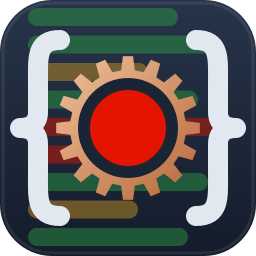
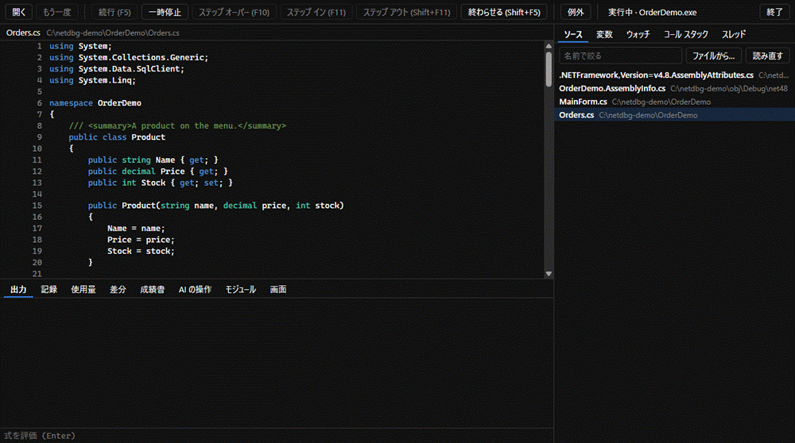
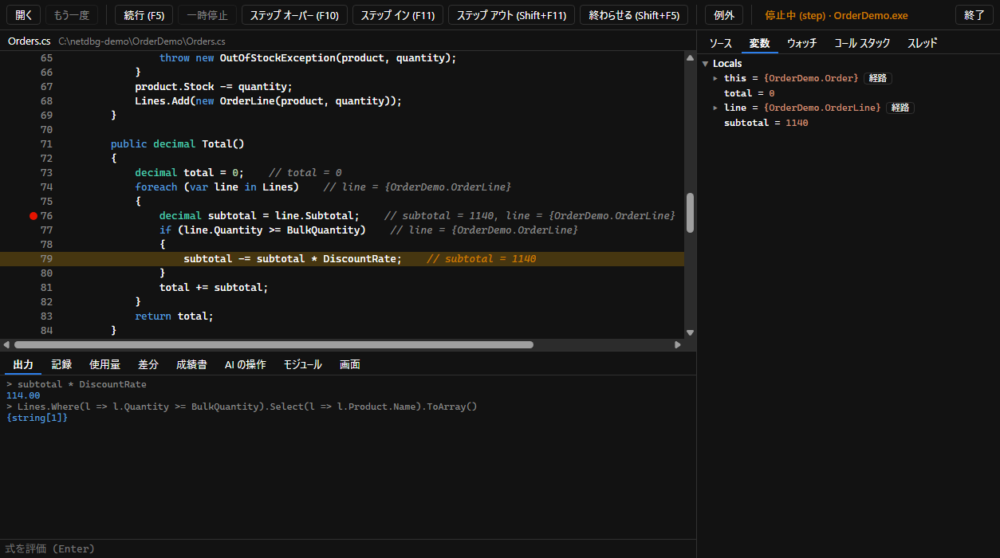
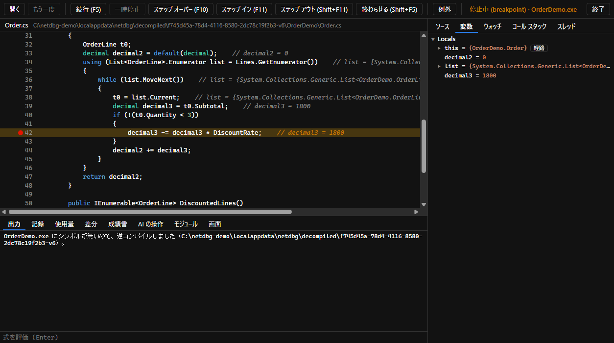
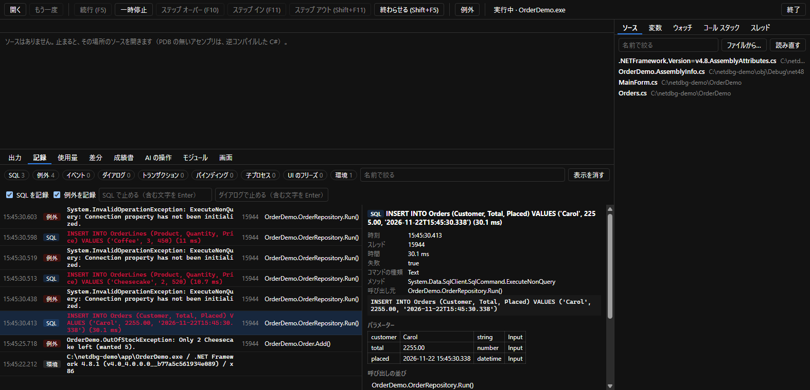
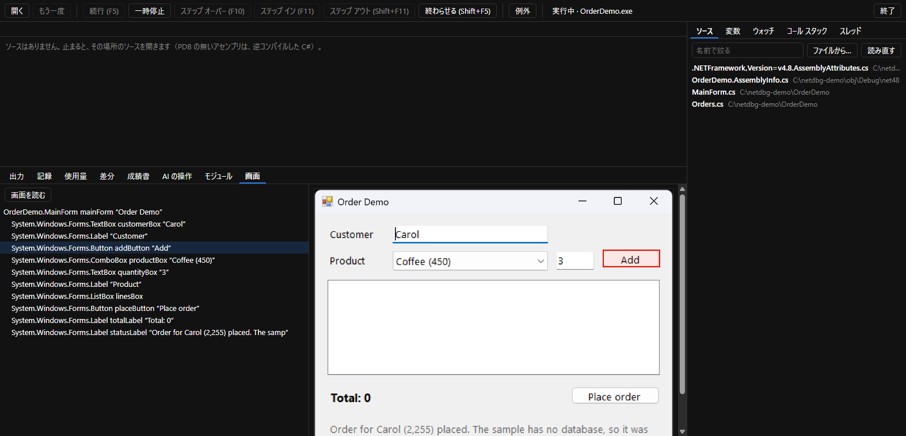
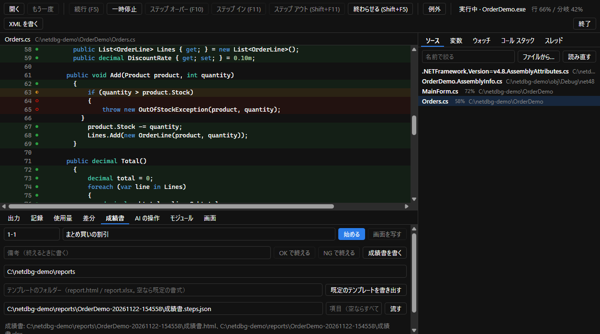
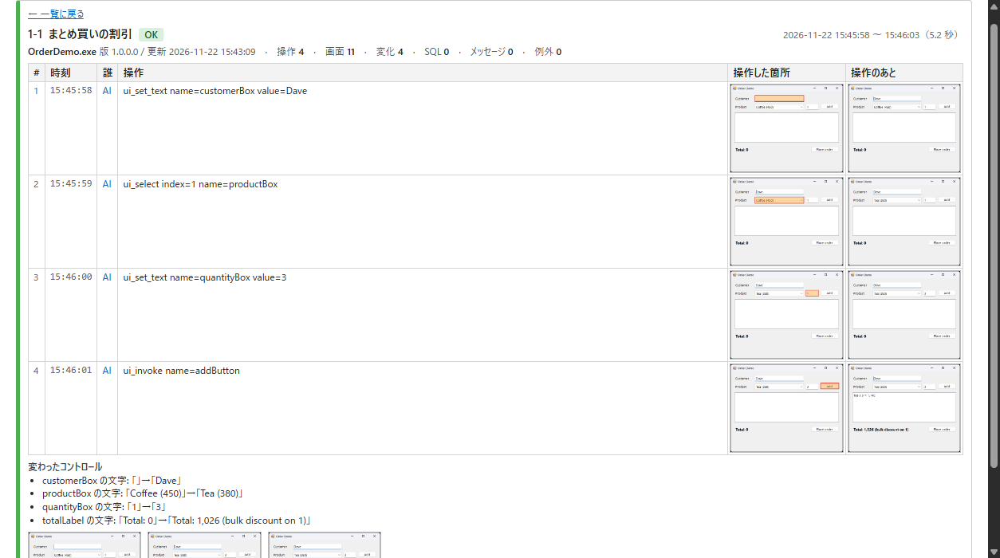
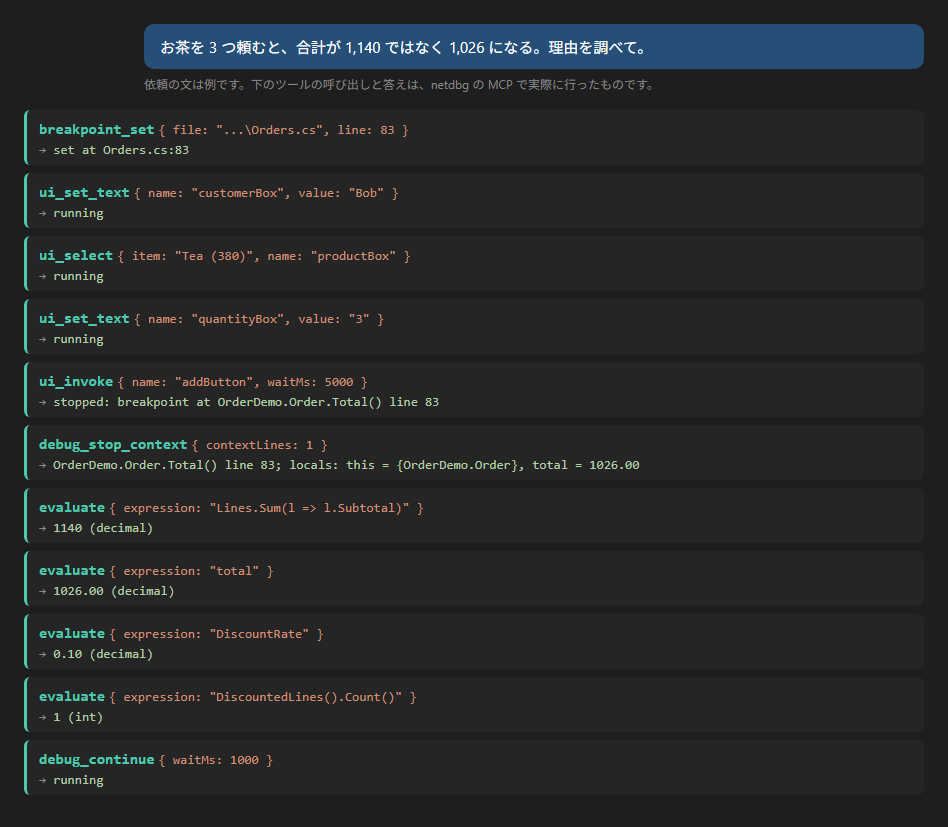
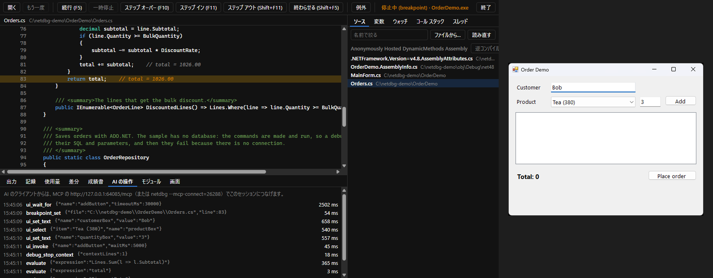

#  netdbg

32 ビットの .NET Framework のプログラムを、ソースが無くても止め、AI と一緒に操作し、試験の成績書まで残すデバッガです。x86 を主な対象として試験しており、.NET(Core 3.0 以降)と x64 でも同じ名前の exe で動きます。x64dbg とは別のプログラムです。

[English](README.md) · 日本語 · [简体中文](README.zh-CN.md) · [繁體中文](README.zh-TW.md) · [한국어](README.ko.md)

WinForms と WPF の画面を名前で操作し、SQL、例外、ダイアログを止めずに記録します。VS Code からは DAP で使います。
ブラウザの専用画面(`netdbg --ui`)だけでも、同じことができます。AI は MCP で、人が開いているセッションに加われます。



**[使い方](guide/usage.jp.md)** · [`samples/OrderDemo`](samples/OrderDemo) の見本で試せます。

## できること

- **2 つのランタイム、2 つのビット数。** .NET(Core 3.0 以降)と .NET Framework 4.x のプログラムを、x86 でも x64 でも。
  エンジンは x86 用と x64 用を作り、プログラムに合う方を使います。
- **エンジンはランタイムを読み込まない。** coreclr.dll と clr.dll を読み込まず、.NET Framework のプログラムなら .NET が
  入っていなくてもデバッグできます。
- **ブレークポイントとステップ。** 行、関数、条件、回数、ログポイント。ステップ イン、オーバー、アウト。async のメソッド。
  例外(投げられたとき、利用者のコードで捕まえないとき、型ごと)。次の文の設定。
- **式。** C# の式を、コンパイラと同じ値と型で評価します。演算子、キャスト、変換、メソッドとプロパティの呼び出し、
  ラムダ、LINQ、`dynamic`、オブジェクト ID。
- **PDB の無いプログラム。** シンボルの無いアセンブリを C# に逆コンパイルし、その行で止まり、ステップし、変数を読めます。
  Windows PDB も読みます。
- **Edit and Continue。** 止めたまま(動かしたままでも)ソースを直して当てます。.NET SDK 9.0.200 以降が要ります(差分はその
  Roslyn で作ります)。
- **プログラムの窓。** WinForms と WPF のコントロールの木、画面の写し、名前で指す入力とクリック、手と AI の操作の記録と、
  その再生。
- **動いている間の記録。** SQL のコマンド、例外、データ バインディングの誤り、ダイアログ、画面の固まり、メモリとハンドルの
  使用量、ヒープの統計、オブジェクトを生かしている経路、カバレッジ(Cobertura XML)、書き込みの見張り(.NET)、
  成績書(Excel と HTML)。
- 動いているプログラムへの**アタッチ**(観察専用にもできる。そのときデバッガーはデータを変えません)。クラッシュダンプ。
- **AI のクライアント**も MCP でデバッグできます。同じブレークポイント、値、窓を、単独でも、人のセッションに加わっても。

## 画面で見る

画像は、netdbg の専用の画面(`netdbg --ui`)で、見本のプログラム(WinForms の注文の画面)をデバッグして撮りました。

### 止めて、値を読み、式を評価する



通った行に変数の値が出ます。いちばん下の行は、ラムダ式や LINQ を含む C# の式を評価します。
[詳しく](guide/usage.jp.md#ブレークポイントステップ式)

### PDB の無いプログラム



[詳しく](guide/usage.jp.md#pdb-の無いプログラム)

### SQL と例外を、止めずに記録する



[詳しく](guide/usage.jp.md#止めずに取る記録)

### プログラムの画面



[詳しく](guide/usage.jp.md#プログラムの画面)

### カバレッジと成績書





[詳しく](guide/usage.jp.md#カバレッジ成績書手順の再生)

## AI から使う (MCP)

AI のクライアントが、デバッガーとプログラムの窓を操作できます。ブレークポイントを置き、文字を入れてボタンを押し、
止まった場所を読み、式を評価します。下は、見本のプログラムで実際に行った呼び出しです。



専用の画面には、AI の操作がその場で並びます。



専用の画面(またはエディターから `--mcp-listen` 付きで動かしたエンジン)のセッションに AI を加えるには、橋渡しを
登録します。Claude Code なら次のとおりです。

```powershell
claude mcp add --scope user netdbg -- "C:\tools\netdbg\x86\netdbg.exe" --mcp-connect
```

AI にエンジンを動かさせるなら、`netdbg.exe --mcp` を登録します。ほかのクライアント(Cursor、Codex、GitHub Copilot CLI、
Gemini CLI など)の設定と、ツールの一覧は[使い方](guide/usage.jp.md#ai-から使う-mcp)にあります。

## 使い方

```text
netdbg [--interpreter=vscode | --mcp | --mcp-listen | --mcp-connect[=<PID>]] [--log=<file>]
netdbg [--log=<file>] --ui [--no-open] [--attach <PID> | <program> [<arguments>...]]
netdbg --decompile <dll> <dir>
netdbg --diff <old> <new> [--coverage <xml>]
```

| 引数 | |
|---|---|
| (無し)、`--interpreter=vscode` | 標準入出力で DAP。 |
| `--ui` | 専用の画面をブラウザで開く(エディター無しでデバッグ)。`--attach <PID>` でアタッチ。プログラムを渡すと、画面が開いたら起動。 |
| `--mcp` | 標準入出力で MCP。AI のクライアントがエンジンを起動して、デバッグに使う。 |
| `--mcp-listen` | DAP に加えて、`127.0.0.1` で MCP。エディターと同じセッションを AI も操作する。 |
| `--mcp-connect[=<PID>]` | 標準入出力の MCP を、`--mcp-listen` で起動したエンジンへ中継する。 |
| `--decompile <dll> <dir>` | PDB の無いアセンブリの C# をフォルダーに書く。 |
| `--diff <old> <new>` | 2 つのビルドで変わったメソッドを出す。カバレッジのファイルを渡すと、変わったのに通っていないメソッドも。 |
| `--log=<file>` | DAP のやり取りと、中の出来事をファイルに書く。 |

専用の画面、MCP と DAP の設定、制限は[使い方](guide/usage.jp.md)にあります。

環境変数 `NETDBG_SYMBOL_DIRS`: PDB を探すフォルダーを足す(`;` で区切る)。

## 組み立て

要るもの: Windows、Rust(rustup)とターゲット `i686-pc-windows-msvc`、`x86_64-pc-windows-msvc`、`wasm32-unknown-unknown`、
MSVC のビルド ツール、`wasm-bindgen-cli`、.NET SDK(Edit and Continue の補助のため)。

```powershell
./build.ps1          # dist\x86\netdbg.exe と dist\x64\netdbg.exe を作る(dbgshim.dll も取ってくる)
```

## 試験

```powershell
cargo test                                   # x86 (既定のターゲット)
cargo test --target x86_64-pc-windows-msvc   # x64
./tests/apps/build.ps1                       # スモーク試験でデバッグするプログラム
./tests/smoke/run.ps1                        # dist\ のエンジンを DAP と MCP で動かす (x86 と x64)
```

スモーク試験は窓を開いてクリックします。流している間は、マウスとキーボードに触らないでください。

## ライセンス

MIT。[LICENSE](LICENSE) を見てください。第三者の告知は [THIRD-PARTY-NOTICES.txt](THIRD-PARTY-NOTICES.txt) にあります
(依存を変えたら `tools/notices/gen-notices.ps1` で作り直す)。
