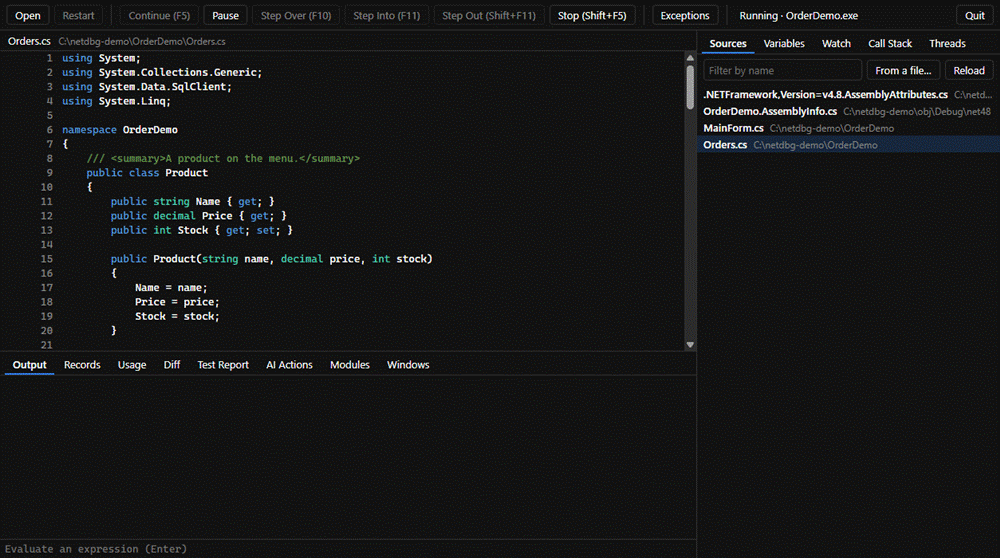
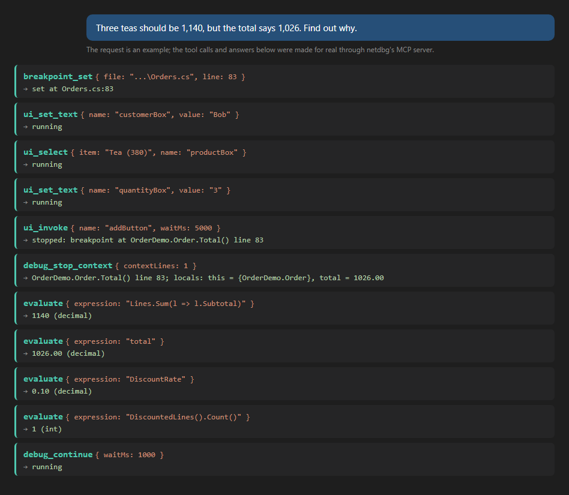
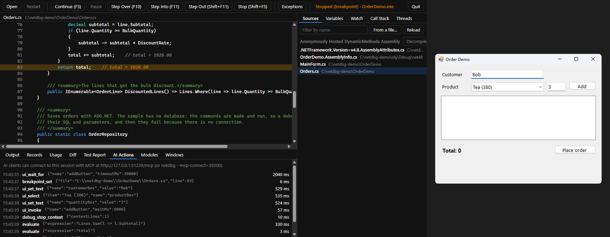

#  netdbg

32비트 .NET Framework 프로그램을 위한 디버거입니다. 소스가 없는 프로그램도 중지하고, AI와 함께 조작하며, 시험 보고서까지 남깁니다. x86을 주 대상으로 테스트합니다. 같은 이름의 exe는 .NET(Core 3.0 이상)과 x64에서도 동작합니다. x64dbg와는 다른 프로그램입니다.

[English](README.md) · [日本語](README.jp.md) · [简体中文](README.zh-CN.md) · [繁體中文](README.zh-TW.md) · 한국어

> 이 문서는 AI가 기계 번역한 것입니다. 잘못된 곳이 있으면 Issue나 Pull Request로 알려 주십시오.

WinForms와 WPF 창을 이름으로 조작하고, 프로그램이 실행되는 동안 SQL, 예외, 대화 상자를 기록합니다. VS Code에서는 DAP로 다룹니다. 브라우저의 전용 화면(`netdbg --ui`)만으로도 같은 일을 할 수 있습니다. AI는 MCP로 사람이 연 세션에 함께할 수 있습니다.



**[사용 설명서](guide/usage.ko.md)** · [`samples/OrderDemo`](samples/OrderDemo)의 예제 프로그램으로 바로 해 볼 수 있습니다.

## 할 수 있는 일

- **두 런타임, 두 비트 수.** .NET(Core 3.0 이상)과 .NET Framework 4.x 프로그램을 x86에서도 x64에서도. 엔진은 x86용과 x64용을 만들며, 프로그램에 맞는 쪽을 씁니다.
- **엔진은 런타임을 로드하지 않습니다.** coreclr.dll과 clr.dll을 로드하지 않으며, .NET Framework 프로그램이라면 .NET이 설치되어 있지 않아도 디버깅할 수 있습니다.
- **중단점과 단계 실행.** 줄, 함수, 조건, 적중 횟수, 로그 지점. 한 단계씩 코드 실행, 프로시저 단위 실행, 프로시저 나가기. async 메서드. 예외(throw될 때, 사용자 코드에서 처리되지 않을 때, 형식별). 다음 문 설정.
- **식.** C# 식을 C# 컴파일러와 같은 값과 형식으로 계산합니다. 연산자, 캐스트, 변환, 메서드와 속성 호출, 람다, LINQ, `dynamic`, 개체 ID.
- **PDB 없는 프로그램.** 기호가 없는 어셈블리를 C#으로 디컴파일하여 그 줄에서 중지하고, 단계 실행하고, 변수를 읽을 수 있습니다. Windows PDB도 읽습니다.
- **편집하며 계속하기.** 중지된 상태(실행 중에도)에서 소스를 고쳐 적용합니다. .NET SDK 9.0.200 이상이 필요합니다(차이는 그 Roslyn으로 만듭니다).
- **프로그램의 창.** WinForms와 WPF 창의 컨트롤 트리, 스크린샷, 이름으로 가리키는 입력과 클릭, 손과 AI 작업의 기록과 다시 실행.
- **실행 중 기록.** SQL 명령, 예외, 데이터 바인딩 오류, 대화 상자, UI 멈춤, 메모리와 핸들 사용량, 힙 통계, 개체를 살려 두는 경로, 코드 커버리지(Cobertura XML), 데이터 중단점(.NET), 테스트 보고서(Excel과 HTML).
- 실행 중인 프로그램에 **연결**(관찰 전용으로도 가능. 이때 디버거는 데이터를 바꾸지 않습니다). 크래시 덤프 열기.
- **AI 클라이언트**도 MCP로 디버깅할 수 있습니다. 같은 중단점, 값, 창을 단독으로도, 사람의 세션에 함께해서도.

## 화면으로 보기

그림은 netdbg 전용 화면(`netdbg --ui`)으로 예제 프로그램(WinForms 주문 화면)을 디버깅하며 찍은 것입니다. 그림 속 화면은 영어이며, 화면은 Windows의 표시 언어(또는 `NETDBG_LANG`)에 따라 한국어로 표시됩니다.

### 중지하고, 값을 읽고, 식을 계산하기


실행된 줄에 변수의 값이 표시됩니다. 맨 아래 줄에서는 람다와 LINQ를 포함한 C# 식을 계산합니다. [자세히](guide/usage.ko.md#중단점-단계-실행-식)

### PDB 없는 프로그램


[자세히](guide/usage.ko.md#pdb-없는-프로그램)

### SQL과 예외를 중지하지 않고 기록하기


[자세히](guide/usage.ko.md#실행-중-기록)

### 프로그램의 창


[자세히](guide/usage.ko.md#프로그램의-창)

### 커버리지와 테스트 보고서


[자세히](guide/usage.ko.md#커버리지-테스트-보고서-다시-실행)

## AI에서 사용하기(MCP)

AI 클라이언트가 디버거와 프로그램의 창을 조작할 수 있습니다. 중단점을 두고, 텍스트를 입력하고 단추를 누른 뒤, 중지된 위치를 읽고 식을 계산합니다. 아래는 예제 프로그램으로 실제로 실행한 호출입니다.



전용 화면에는 AI의 작업이 그 자리에서 나열됩니다.



전용 화면(또는 편집기에서 `--mcp-listen`으로 시작한 엔진)의 세션에 AI를 참여시키려면 브리지를 등록합니다. Claude Code라면 다음과 같습니다.

```powershell
claude mcp add --scope user netdbg -- "C:\tools\netdbg\x86\netdbg.exe" --mcp-connect
```

AI가 엔진을 직접 실행하게 하려면 `netdbg.exe --mcp`를 등록합니다. 다른 클라이언트(Cursor, Codex, GitHub Copilot CLI, Gemini CLI 등)의 설정과 도구 목록은 [사용 설명서](guide/usage.ko.md#ai에서-사용하기mcp)에 있습니다.

## 사용법

```text
netdbg [--interpreter=vscode | --mcp | --mcp-listen | --mcp-connect[=<PID>]] [--log=<file>]
netdbg [--log=<file>] --ui [--no-open] [--attach <PID> | <program> [<arguments>...]]
netdbg --decompile <dll> <dir>
netdbg --diff <old> <new> [--coverage <xml>]
```

| 옵션 | |
|---|---|
| (없음), `--interpreter=vscode` | 표준 입출력으로 DAP. |
| `--ui` | 전용 화면을 브라우저로 엽니다(편집기 없이 디버깅). `--attach <PID>`로 연결. 프로그램을 주면 화면이 열린 뒤 시작합니다. |
| `--mcp` | 표준 입출력으로 MCP. AI 클라이언트가 엔진을 시작해 디버깅에 씁니다. |
| `--mcp-listen` | DAP에 더해 `127.0.0.1`에서 MCP. 편집기와 같은 세션을 AI도 조작합니다. |
| `--mcp-connect[=<PID>]` | 표준 입출력의 MCP를 `--mcp-listen`으로 시작한 엔진으로 전달합니다. |
| `--decompile <dll> <dir>` | PDB 없는 어셈블리의 C#을 폴더에 씁니다. |
| `--diff <old> <new>` | 두 빌드 사이에 바뀐 메서드를 출력합니다. 커버리지 파일을 주면 바뀌었지만 실행되지 않은 메서드도. |
| `--log=<file>` | DAP 통신과 내부 이벤트를 파일에 씁니다. |

전용 화면, MCP와 DAP 설정, 제한은 [사용 설명서](guide/usage.ko.md)에 있습니다.

환경 변수 `NETDBG_SYMBOL_DIRS`: PDB를 찾을 폴더를 더합니다(`;`로 구분).

## 빌드

필요한 것: Windows, Rust(rustup)와 대상 `i686-pc-windows-msvc`, `x86_64-pc-windows-msvc`, `wasm32-unknown-unknown`, MSVC 빌드 도구, `wasm-bindgen-cli`, .NET SDK(편집하며 계속하기 도우미용).

```powershell
./build.ps1          # dist\x86\netdbg.exe와 dist\x64\netdbg.exe를 만듭니다(dbgshim.dll도 가져옴)
```

## 테스트

```powershell
cargo test                                   # x86(기본 대상)
cargo test --target x86_64-pc-windows-msvc   # x64
./tests/apps/build.ps1                       # 스모크 테스트에서 디버깅할 프로그램
./tests/smoke/run.ps1                        # dist\의 엔진을 DAP와 MCP로 구동(x86과 x64)
```

스모크 테스트는 창을 열고 클릭합니다. 실행하는 동안 마우스와 키보드를 만지지 마십시오.

## 라이선스

MIT. [LICENSE](LICENSE)를 보십시오. 타사 고지는 [THIRD-PARTY-NOTICES.txt](THIRD-PARTY-NOTICES.txt)에 있습니다(종속성을 바꾸면 `tools/notices/gen-notices.ps1`로 다시 만드십시오).
