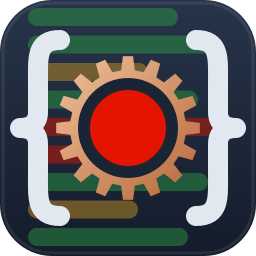
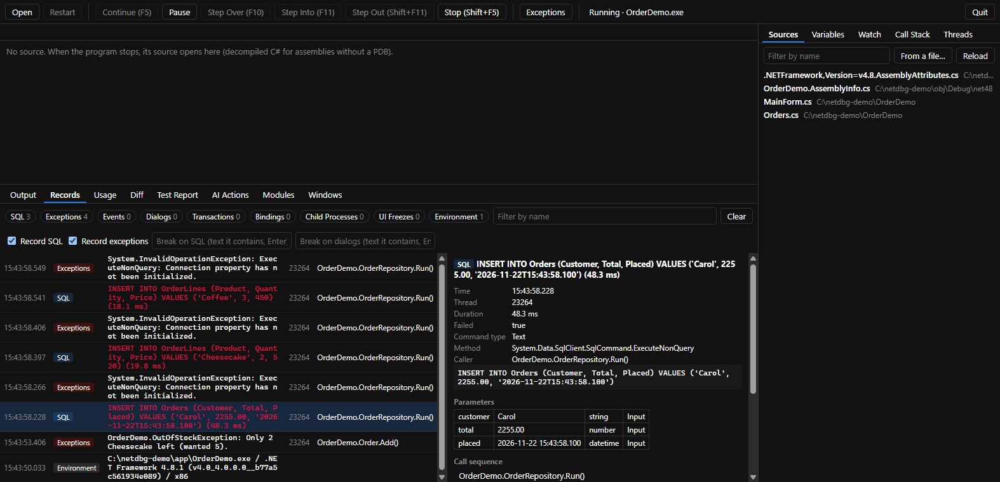

#  netdbg

A debugger for 32-bit .NET Framework programs. It stops them, including a build that ships without source. An AI can
work in the same session, and the session writes a test report. Checked first on x86. The same exe name also runs for
.NET (Core 3.0 and later) and on x64. A different program from x64dbg.

English · [日本語](README.jp.md) · [简体中文](README.zh-CN.md) · [繁體中文](README.zh-TW.md) · [한국어](README.ko.md)

It drives WinForms and WPF windows by name, and records SQL, exceptions and dialogs while the program runs. VS Code
drives it over DAP. The browser screen (`netdbg --ui`) does the same on its own. An AI client joins the open session
over MCP.


**[Usage guide](guide/usage.md)** · Try it with the sample in [`samples/OrderDemo`](samples/OrderDemo).

## What it does

- **Both runtimes, both bitnesses.** .NET (Core 3.0 and later) and .NET Framework 4.x programs, as x86 or x64. An x86
  build and an x64 build of the engine are made; use the one that matches the program.
- **No runtime inside the engine.** The engine never loads coreclr.dll or clr.dll, and it needs no .NET installation to
  debug .NET Framework programs.
- **Breakpoints and stepping.** Line, function, conditional, hit-count and log points; step in, over and out; async
  methods; exceptions (thrown, user-unhandled, by type); set next statement.
- **Expressions.** C# expressions are evaluated with the compiler's values and types: operators, casts, conversions,
  method and property calls, lambdas, LINQ, `dynamic`, object IDs.
- **Programs without a PDB.** Assemblies without symbols are decompiled to C# so you can stop on their lines, step and
  read variables. Windows PDBs are read too.
- **Edit and Continue.** Change the source while stopped (or running) and apply it, when a .NET SDK 9.0.200 or later is
  installed (the deltas are made with its Roslyn).
- **Windows of the program.** The control tree of WinForms and WPF windows, screenshots, typing and clicking by name,
  recording of what was done by hand and by AI, and replaying it.
- **Records while running.** SQL commands, exceptions, data-binding errors, dialogs, UI freezes, memory and handle use,
  heap statistics, the path that keeps an object alive, code coverage (Cobertura XML), data breakpoints (.NET), test
  reports (Excel and HTML).
- **Attach** to a running program, also only to observe (the debugger then changes no data). Open crash dumps.
- **AI clients** debug through MCP: the same breakpoints, values and windows, alone or in your session.

## See it

The pictures are taken from netdbg's own screen (`netdbg --ui`) while it debugs the sample, a WinForms order screen.

### Stop, read values, evaluate


Values of the variables are shown on the lines already run; the line at the bottom evaluates C# with lambdas and LINQ.
[More](guide/usage.md#breakpoints-stepping-and-expressions)

### Programs without a PDB


[More](guide/usage.md#programs-without-a-pdb)

### SQL and exceptions, recorded without stopping



[More](guide/usage.md#records-while-running)

### The program's windows


[More](guide/usage.md#the-programs-windows)

### Coverage and test reports


[More](guide/usage.md#coverage-test-reports-and-replay)

## AI clients (MCP)

An AI client can drive the debugger and the program's windows: set breakpoints, type and click, then read where the
program stopped and evaluate expressions. These are real calls made with the sample:


On the screen, the AI's actions are listed as they happen:


To let an AI join the session you have open on the screen (or in the editor with `--mcp-listen`), register the bridge,
for example in Claude Code:

```powershell
claude mcp add --scope user netdbg -- "C:\tools\netdbg\x86\netdbg.exe" --mcp-connect
```

Or register `netdbg.exe --mcp` for the AI to run the engine by itself. Settings for other clients (Cursor, Codex,
GitHub Copilot CLI, Gemini CLI and others) and the list of tools are in the
[usage guide](guide/usage.md#ai-clients-mcp).

## Use

```text
netdbg [--interpreter=vscode | --mcp | --mcp-listen | --mcp-connect[=<PID>]] [--log=<file>]
netdbg [--log=<file>] --ui [--no-open] [--attach <PID> | <program> [<arguments>...]]
netdbg --decompile <dll> <dir>
netdbg --diff <old> <new> [--coverage <xml>]
```

| Option | |
|---|---|
| (none), `--interpreter=vscode` | DAP over standard input and output. |
| `--ui` | The debugger's own screen in the browser (no editor needed). `--attach <PID>` attaches; a program is launched when the screen opens. |
| `--mcp` | MCP over standard input and output: an AI client starts the engine and debugs with it. |
| `--mcp-listen` | DAP, plus MCP on `127.0.0.1`, so that an AI works with the same session as the editor. |
| `--mcp-connect[=<PID>]` | Bridges MCP on standard input and output to an engine started with `--mcp-listen`. |
| `--decompile <dll> <dir>` | Writes the C# of an assembly without a PDB into a folder. |
| `--diff <old> <new>` | Lists the methods that changed between two builds, and with a coverage file, the changed methods that were not run. |
| `--log=<file>` | Writes the DAP traffic and internal events to a file. |

See the [usage guide](guide/usage.md) for the screen, the MCP and DAP settings, and the limits.

Environment variable `NETDBG_SYMBOL_DIRS`: extra folders to search for PDBs (separated by `;`).

## Build

Requirements: Windows, Rust (rustup) with the targets `i686-pc-windows-msvc`, `x86_64-pc-windows-msvc` and
`wasm32-unknown-unknown`, the MSVC build tools, `wasm-bindgen-cli`, and the .NET SDK (for the Edit and Continue helper).

```powershell
./build.ps1          # builds dist\x86\netdbg.exe and dist\x64\netdbg.exe (and fetches dbgshim.dll)
```

## Test

```powershell
cargo test                                   # x86 (the default target)
cargo test --target x86_64-pc-windows-msvc   # x64
./tests/apps/build.ps1                       # the programs the smoke tests debug
./tests/smoke/run.ps1                        # drives dist\ over DAP and MCP (x86 and x64)
```

The smoke tests open windows and click in them; do not use the mouse or keyboard while they run.

## License

MIT. See [LICENSE](LICENSE). Third-party notices are in [THIRD-PARTY-NOTICES.txt](THIRD-PARTY-NOTICES.txt)
(regenerate with `tools/notices/gen-notices.ps1` after changing dependencies).
