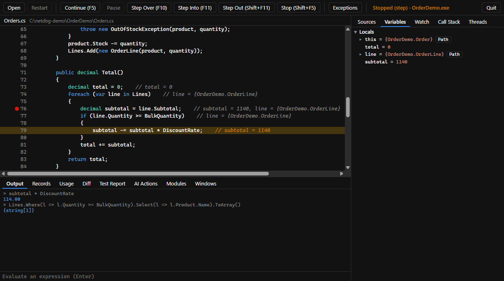

#  netdbg

面向 32 位 .NET Framework 程序的调试器。没有源代码的程序也能停下，可以和 AI 一起操作，并留下测试报告。以 x86 为主要测试对象。同名的 exe 也可用于 .NET（Core 3.0 及更高版本）和 x64。与 x64dbg 是不同的程序。

[English](README.md) · [日本語](README.jp.md) · 简体中文 · [繁體中文](README.zh-TW.md) · [한국어](README.ko.md)

> 本文档由 AI 机器翻译。如有错误，欢迎通过 Issue 或 Pull Request 指正。

按名称操作 WinForms 和 WPF 窗口，并在程序运行期间记录 SQL、异常和对话框。VS Code 通过 DAP 驱动它。自带的浏览器界面（`netdbg --ui`）也可以单独完成同样的事。AI 客户端通过 MCP 加入已打开的会话。


**[使用指南](guide/usage.zh-CN.md)** · 可以用 [`samples/OrderDemo`](samples/OrderDemo) 中的示例程序试用。

## 功能

- **两种运行时、两种位数。** 支持 .NET（Core 3.0 及更高版本）和 .NET Framework 4.x 程序，x86 和 x64 均可。引擎分别生成 x86 版和 x64 版，请使用与程序相符的一个。
- **引擎内不加载运行时。** 引擎从不加载 coreclr.dll 或 clr.dll；调试 .NET Framework 程序时，不需要安装 .NET。
- **断点和单步执行。** 行断点、函数断点、条件断点、命中次数和日志点；逐语句、逐过程、跳出；async 方法；异常（引发时、用户代码未处理时、按类型）；设置下一条语句。
- **表达式。** 按照与 C# 编译器相同的值和类型计算 C# 表达式：运算符、强制转换、转换、方法和属性调用、lambda、LINQ、`dynamic`、对象 ID。
- **没有 PDB 的程序。** 将没有符号的程序集反编译为 C#，可以在其中的行停止、单步执行并读取变量。也能读取 Windows PDB。
- **编辑并继续。** 在停止时（运行时也可以）修改源代码并应用。需要 .NET SDK 9.0.200 或更高版本（差异由其 Roslyn 生成）。
- **程序的窗口。** WinForms 和 WPF 窗口的控件树、截图、按名称输入和单击、记录手动和 AI 的操作并重放。
- **运行时的记录。** SQL 命令、异常、数据绑定错误、对话框、界面冻结、内存和句柄的使用情况、堆统计、使对象保持存活的路径、代码覆盖率（Cobertura XML）、数据断点（.NET）、测试报告（Excel 和 HTML）。
- **附加**到正在运行的程序，也可以仅观察（此时调试器不会更改任何数据）。打开故障转储。
- **AI 客户端**通过 MCP 进行调试：同样的断点、值和窗口，既可以单独使用，也可以加入您的会话。

## 看看效果

以下图片是用 netdbg 自己的界面（`netdbg --ui`）调试示例程序（WinForms 的订单界面）时截取的。截图中的界面为英文；界面会按 Windows 的显示语言（或 `NETDBG_LANG`）以简体中文显示。

### 停止、读取值、计算表达式



已运行的行上会显示变量的值；底部的行可以计算包含 lambda 和 LINQ 的 C# 表达式。[详细](guide/usage.zh-CN.md#断点单步执行和表达式)

### 没有 PDB 的程序


[详细](guide/usage.zh-CN.md#没有-pdb-的程序)

### 不停止地记录 SQL 和异常


[详细](guide/usage.zh-CN.md#运行时的记录)

### 程序的窗口


[详细](guide/usage.zh-CN.md#程序的窗口)

### 覆盖率和测试报告


[详细](guide/usage.zh-CN.md#覆盖率测试报告和重放)

## 从 AI 使用（MCP）

AI 客户端可以操作调试器和程序的窗口：设置断点、输入文本并单击按钮，然后读取停止的位置并计算表达式。以下是用示例程序实际进行的调用：


AI 的操作会实时显示在界面上：


要让 AI 加入您在界面（或用 `--mcp-listen` 从编辑器启动的引擎）中打开的会话，请注册桥接。以 Claude Code 为例：

```powershell
claude mcp add --scope user netdbg -- "C:\tools\netdbg\x86\netdbg.exe" --mcp-connect
```

如果要让 AI 自己运行引擎，请注册 `netdbg.exe --mcp`。其他客户端（Cursor、Codex、GitHub Copilot CLI、Gemini CLI 等）的设置和工具列表请参阅[使用指南](guide/usage.zh-CN.md#从-ai-使用mcp)。

## 用法

```text
netdbg [--interpreter=vscode | --mcp | --mcp-listen | --mcp-connect[=<PID>]] [--log=<file>]
netdbg [--log=<file>] --ui [--no-open] [--attach <PID> | <program> [<arguments>...]]
netdbg --decompile <dll> <dir>
netdbg --diff <old> <new> [--coverage <xml>]
```

| 选项 | |
|---|---|
| （无）、`--interpreter=vscode` | 通过标准输入和输出使用 DAP。 |
| `--ui` | 在浏览器中打开调试器自己的界面（无需编辑器即可调试）。`--attach <PID>` 附加；指定程序时，界面打开后即启动它。 |
| `--mcp` | 通过标准输入和输出使用 MCP：AI 客户端启动引擎并用它调试。 |
| `--mcp-listen` | 使用 DAP，同时在 `127.0.0.1` 上打开 MCP，使 AI 与编辑器操作同一个会话。 |
| `--mcp-connect[=<PID>]` | 将标准输入和输出上的 MCP 桥接到用 `--mcp-listen` 启动的引擎。 |
| `--decompile <dll> <dir>` | 将没有 PDB 的程序集的 C# 写入文件夹。 |
| `--diff <old> <new>` | 列出两次生成之间更改的方法；指定覆盖率文件时，还会列出已更改但未运行的方法。 |
| `--log=<file>` | 将 DAP 通信和内部事件写入文件。 |

界面、MCP 和 DAP 的设置以及限制请参阅[使用指南](guide/usage.zh-CN.md)。

环境变量 `NETDBG_SYMBOL_DIRS`：额外搜索 PDB 的文件夹（用 `;` 分隔）。

## 生成

需要：Windows、Rust（rustup）及目标 `i686-pc-windows-msvc`、`x86_64-pc-windows-msvc`、`wasm32-unknown-unknown`，MSVC 生成工具，`wasm-bindgen-cli`，以及 .NET SDK（用于编辑并继续的辅助程序）。

```powershell
./build.ps1          # 生成 dist\x86\netdbg.exe 和 dist\x64\netdbg.exe（并获取 dbgshim.dll）
```

## 测试

```powershell
cargo test                                   # x86（默认目标）
cargo test --target x86_64-pc-windows-msvc   # x64
./tests/apps/build.ps1                       # 冒烟测试要调试的程序
./tests/smoke/run.ps1                        # 通过 DAP 和 MCP 驱动 dist\ 中的引擎（x86 和 x64）
```

冒烟测试会打开窗口并在其中单击；运行期间请不要使用鼠标和键盘。

## 许可证

MIT。请参阅 [LICENSE](LICENSE)。第三方声明在 [THIRD-PARTY-NOTICES.txt](THIRD-PARTY-NOTICES.txt) 中（更改依赖项后用 `tools/notices/gen-notices.ps1` 重新生成）。
