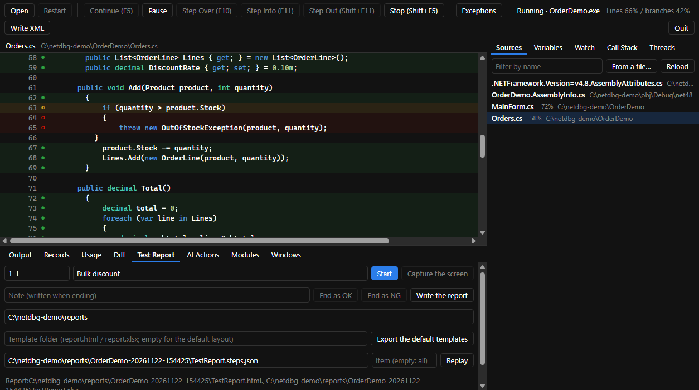

#  netdbg

適用於 32 位元 .NET Framework 程式的偵錯工具。沒有原始碼的程式也能停止，可以和 AI 一起操作，並留下測試報告。以 x86 為主要測試對象。同名的 exe 也可用於 .NET（Core 3.0 及更新版本）和 x64。與 x64dbg 是不同的程式。

[English](README.md) · [日本語](README.jp.md) · [简体中文](README.zh-CN.md) · 繁體中文 · [한국어](README.ko.md)

> 本文件由 AI 機器翻譯。如有錯誤，歡迎透過 Issue 或 Pull Request 指正。

依名稱操作 WinForms 和 WPF 視窗，並在程式執行期間記錄 SQL、例外狀況和對話方塊。VS Code 透過 DAP 驅動它。自帶的瀏覽器畫面（`netdbg --ui`）也可以單獨完成同樣的事。AI 用戶端透過 MCP 加入已開啟的工作階段。


**[使用指南](guide/usage.zh-TW.md)** · 可以用 [`samples/OrderDemo`](samples/OrderDemo) 中的範例程式試用。

## 功能

- **兩種執行階段、兩種位元數。** 支援 .NET（Core 3.0 及更新版本）和 .NET Framework 4.x 程式，x86 和 x64 皆可。引擎分別建置 x86 版和 x64 版，請使用與程式相符的一個。
- **引擎內不載入執行階段。** 引擎從不載入 coreclr.dll 或 clr.dll；偵錯 .NET Framework 程式時，不需要安裝 .NET。
- **中斷點和逐步執行。** 行中斷點、函式中斷點、條件中斷點、叫用次數和記錄點；逐步執行、不進入函式、跳離函式；async 方法；例外狀況（擲回時、使用者程式碼未處理時、依型別）；設定下一個陳述式。
- **運算式。** 依照與 C# 編譯器相同的值和型別評估 C# 運算式：運算子、轉換、方法和屬性呼叫、Lambda、LINQ、`dynamic`、物件 ID。
- **沒有 PDB 的程式。** 將沒有符號的組件反編譯為 C#，可以在其中的行停止、逐步執行並讀取變數。也能讀取 Windows PDB。
- **編輯後繼續。** 在停止時（執行時也可以）修改原始程式碼並套用。需要 .NET SDK 9.0.200 或更新版本（差異由其 Roslyn 產生）。
- **程式的視窗。** WinForms 和 WPF 視窗的控制項樹狀結構、截圖、依名稱輸入和按一下、記錄手動和 AI 的操作並重新執行。
- **執行時的記錄。** SQL 命令、例外狀況、資料繫結錯誤、對話方塊、UI 凍結、記憶體和控制代碼的使用量、堆積統計、使物件保持存活的路徑、程式碼涵蓋範圍（Cobertura XML）、資料中斷點（.NET）、測試報告（Excel 和 HTML）。
- **附加**至正在執行的程式，也可以僅觀察（此時偵錯工具不會變更任何資料）。開啟損毀傾印。
- **AI 用戶端**透過 MCP 進行偵錯：同樣的中斷點、值和視窗，既可以單獨使用，也可以加入您的工作階段。

## 看看效果

以下圖片是用 netdbg 自己的畫面（`netdbg --ui`）偵錯範例程式（WinForms 的訂單畫面）時擷取的。截圖中的畫面為英文；畫面會依 Windows 的顯示語言（或 `NETDBG_LANG`）以繁體中文顯示。

### 停止、讀取值、評估運算式


已執行的行上會顯示變數的值；底部的行可以評估包含 Lambda 和 LINQ 的 C# 運算式。[詳細](guide/usage.zh-TW.md#中斷點逐步執行和運算式)

### 沒有 PDB 的程式


[詳細](guide/usage.zh-TW.md#沒有-pdb-的程式)

### 不停止地記錄 SQL 和例外狀況


[詳細](guide/usage.zh-TW.md#執行時的記錄)

### 程式的視窗


[詳細](guide/usage.zh-TW.md#程式的視窗)

### 涵蓋範圍和測試報告




[詳細](guide/usage.zh-TW.md#涵蓋範圍測試報告和重新執行)

## 從 AI 使用（MCP）

AI 用戶端可以操作偵錯工具和程式的視窗：設定中斷點、輸入文字並按下按鈕，然後讀取停止的位置並評估運算式。以下是用範例程式實際進行的呼叫：


AI 的操作會即時顯示在畫面上：


要讓 AI 加入您在畫面（或用 `--mcp-listen` 從編輯器啟動的引擎）中開啟的工作階段，請註冊橋接。以 Claude Code 為例：

```powershell
claude mcp add --scope user netdbg -- "C:\tools\netdbg\x86\netdbg.exe" --mcp-connect
```

如果要讓 AI 自己執行引擎，請註冊 `netdbg.exe --mcp`。其他用戶端（Cursor、Codex、GitHub Copilot CLI、Gemini CLI 等）的設定和工具清單請參閱[使用指南](guide/usage.zh-TW.md#從-ai-使用mcp)。

## 用法

```text
netdbg [--interpreter=vscode | --mcp | --mcp-listen | --mcp-connect[=<PID>]] [--log=<file>]
netdbg [--log=<file>] --ui [--no-open] [--attach <PID> | <program> [<arguments>...]]
netdbg --decompile <dll> <dir>
netdbg --diff <old> <new> [--coverage <xml>]
```

| 選項 | |
|---|---|
| （無）、`--interpreter=vscode` | 透過標準輸入和輸出使用 DAP。 |
| `--ui` | 在瀏覽器中開啟偵錯工具自己的畫面（不需要編輯器即可偵錯）。`--attach <PID>` 附加；指定程式時，畫面開啟後即啟動它。 |
| `--mcp` | 透過標準輸入和輸出使用 MCP：AI 用戶端啟動引擎並用它偵錯。 |
| `--mcp-listen` | 使用 DAP，同時在 `127.0.0.1` 上開啟 MCP，使 AI 與編輯器操作同一個工作階段。 |
| `--mcp-connect[=<PID>]` | 將標準輸入和輸出上的 MCP 橋接到用 `--mcp-listen` 啟動的引擎。 |
| `--decompile <dll> <dir>` | 將沒有 PDB 的組件的 C# 寫入資料夾。 |
| `--diff <old> <new>` | 列出兩次建置之間變更的方法；指定涵蓋範圍檔案時，也會列出已變更但未執行的方法。 |
| `--log=<file>` | 將 DAP 通訊和內部事件寫入檔案。 |

畫面、MCP 和 DAP 的設定以及限制請參閱[使用指南](guide/usage.zh-TW.md)。

環境變數 `NETDBG_SYMBOL_DIRS`：額外搜尋 PDB 的資料夾（以 `;` 分隔）。

## 建置

需要：Windows、Rust（rustup）及目標 `i686-pc-windows-msvc`、`x86_64-pc-windows-msvc`、`wasm32-unknown-unknown`，MSVC 建置工具，`wasm-bindgen-cli`，以及 .NET SDK（用於編輯後繼續的協助程式）。

```powershell
./build.ps1          # 建置 dist\x86\netdbg.exe 和 dist\x64\netdbg.exe（並取得 dbgshim.dll）
```

## 測試

```powershell
cargo test                                   # x86（預設目標）
cargo test --target x86_64-pc-windows-msvc   # x64
./tests/apps/build.ps1                       # 煙霧測試要偵錯的程式
./tests/smoke/run.ps1                        # 透過 DAP 和 MCP 驅動 dist\ 中的引擎（x86 和 x64）
```

煙霧測試會開啟視窗並在其中按一下；執行期間請不要使用滑鼠和鍵盤。

## 授權

MIT。請參閱 [LICENSE](LICENSE)。第三方聲明在 [THIRD-PARTY-NOTICES.txt](THIRD-PARTY-NOTICES.txt) 中（變更相依性後以 `tools/notices/gen-notices.ps1` 重新產生）。
