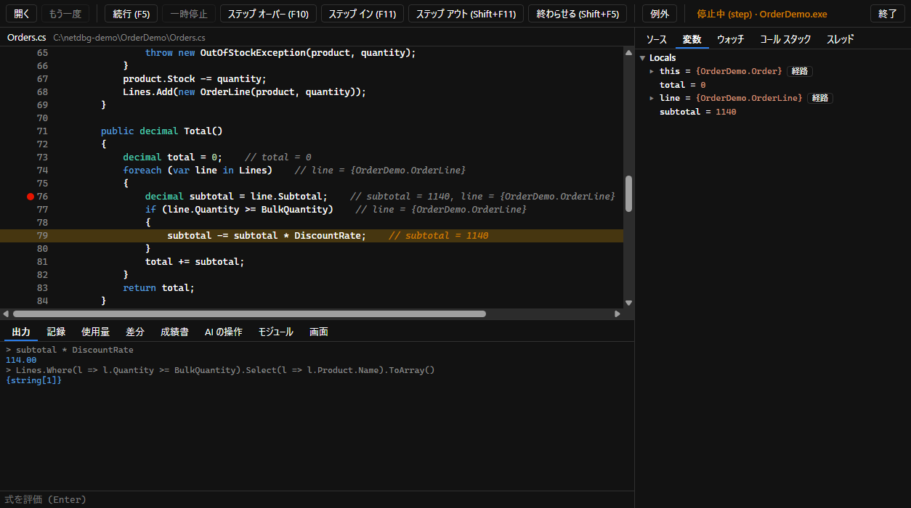
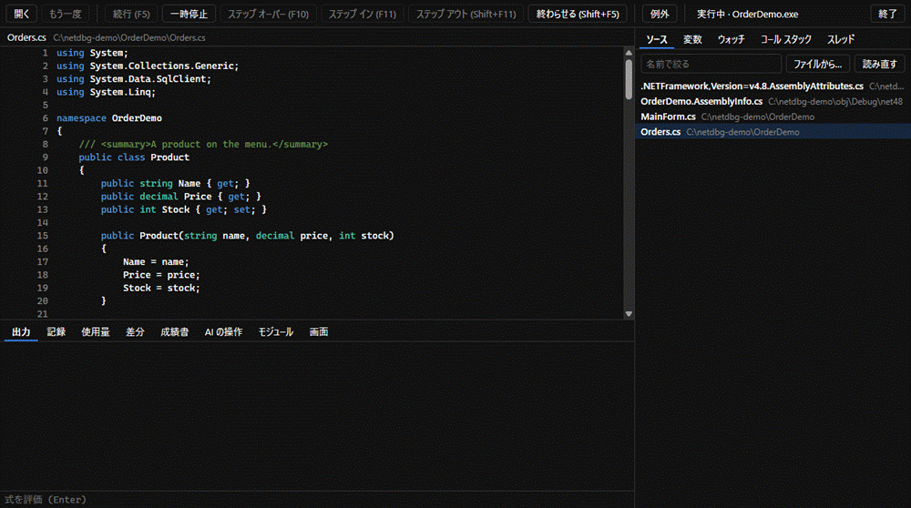
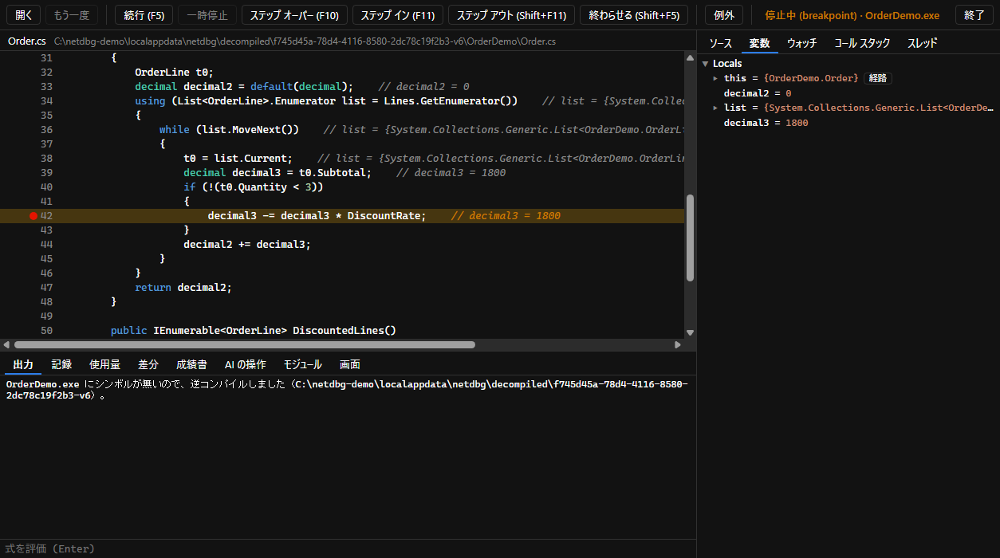
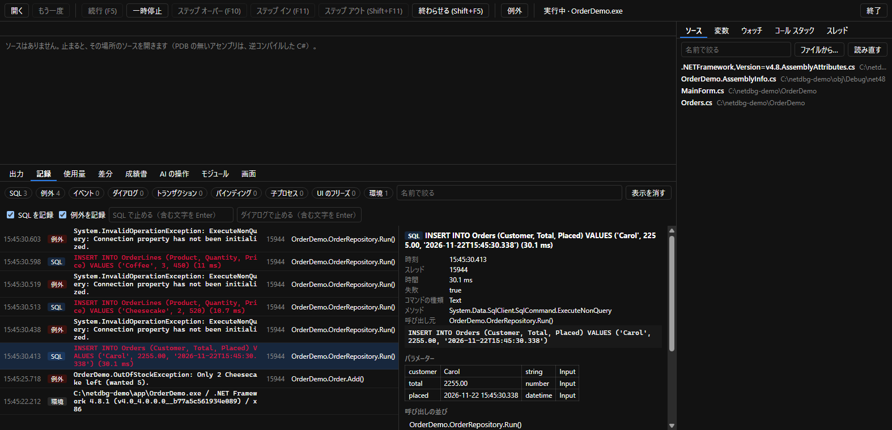
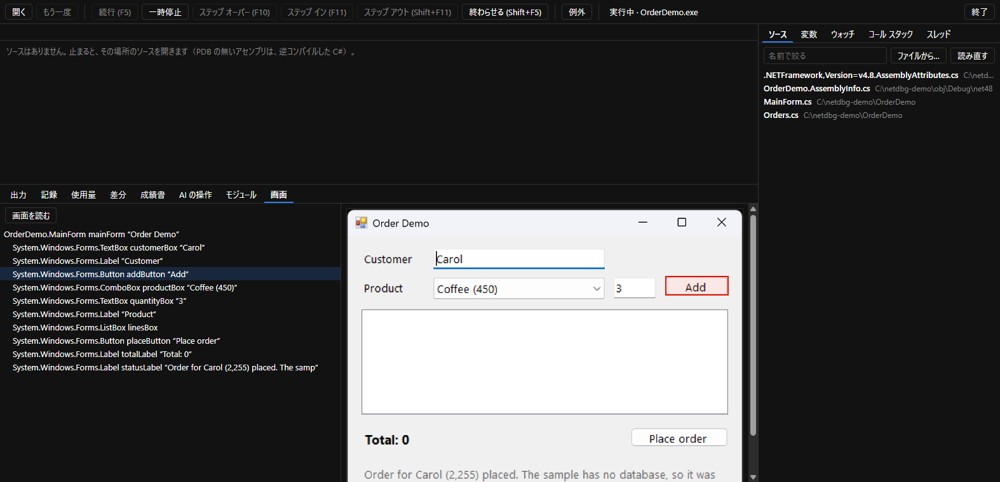
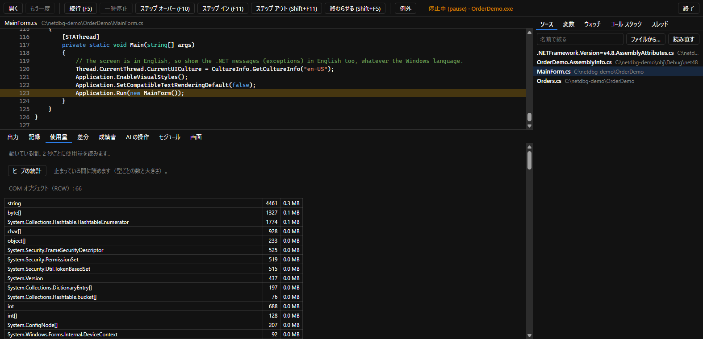
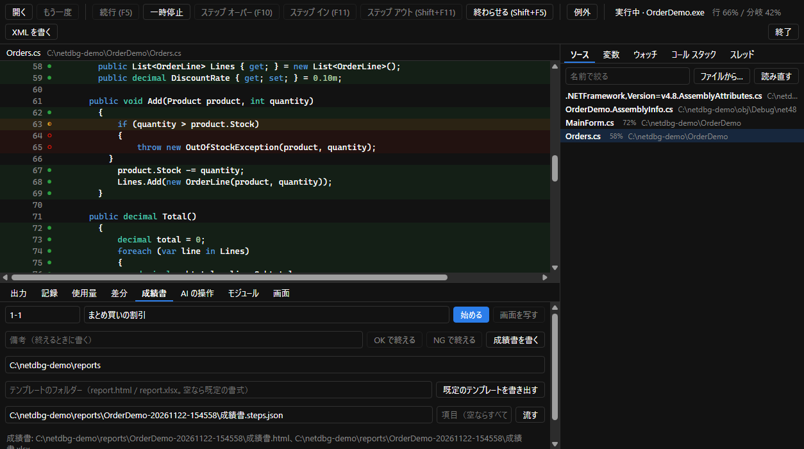
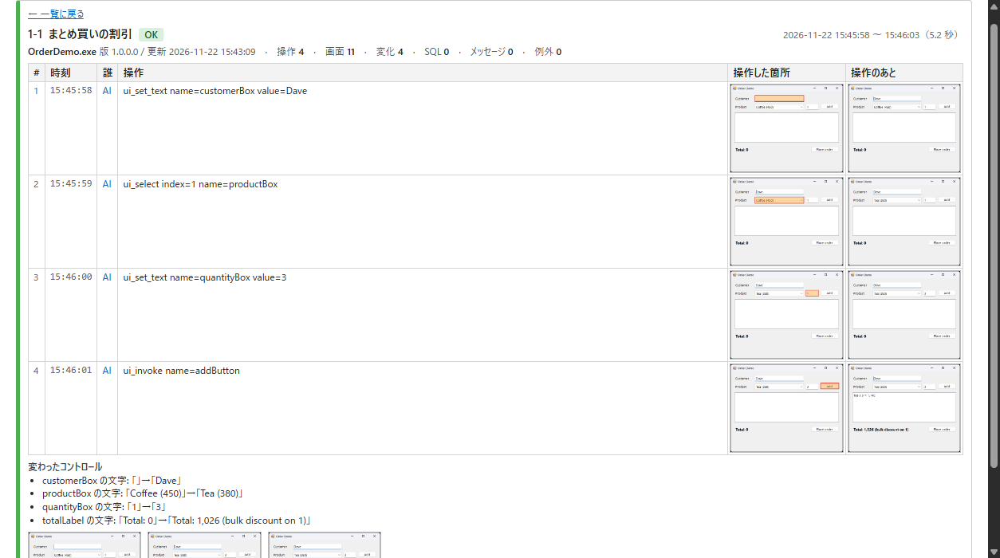
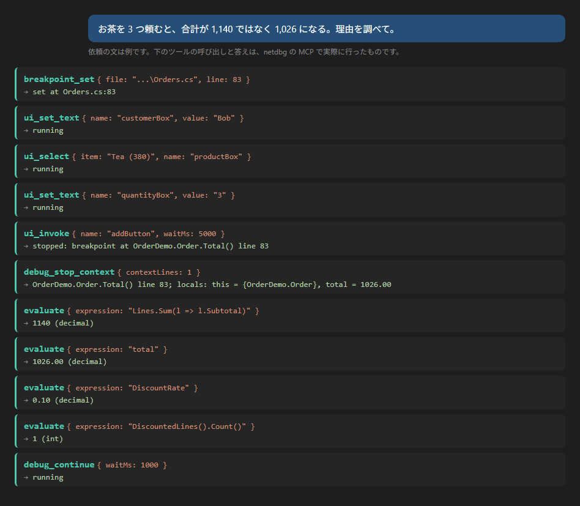
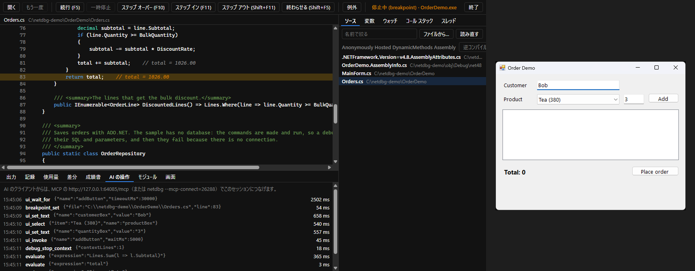

# netdbg 使い方

[English](usage.md) · 日本語 · [简体中文](usage.zh-CN.md) · [繁體中文](usage.zh-TW.md) · [한국어](usage.ko.md) · [README](../README.jp.md)

netdbg の使い方を、専用の画面(`--ui`)、AI のクライアント(MCP)、エディター(DAP)の順に説明します。画像は、
見本のプログラム [`samples/OrderDemo`](../samples/OrderDemo)(.NET Framework 4.8、x86 の、小さな WinForms の注文の
画面)をデバッグして撮ったものです。

- [始め方](#始め方)
- [専用の画面 (`--ui`)](#専用の画面---ui)
- [ブレークポイント、ステップ、式](#ブレークポイントステップ式)
- [PDB の無いプログラム](#pdb-の無いプログラム)
- [止めずに取る記録](#止めずに取る記録)
- [プログラムの画面](#プログラムの画面)
- [使用量、ヒープ、漏れ](#使用量ヒープ漏れ)
- [カバレッジ、成績書、手順の再生](#カバレッジ成績書手順の再生)
- [Edit and Continue](#edit-and-continue)
- [AI から使う (MCP)](#ai-から使う-mcp)
- [エディターから使う (DAP)](#エディターから使う-dap)
- [コマンドライン](#コマンドライン)
- [制限と、困ったとき](#制限と困ったとき)

## 始め方

1. エンジンを組み立てます([README](../README.jp.md#組み立て))。`dist\x86\netdbg.exe` と `dist\x64\netdbg.exe` が
   できます。2 つのフォルダーは並べたままにしてください。専用の画面は、ビット数の違うプログラムを、もう一方の
   エンジンに任せます。
2. 見本のプログラムを組み立てます。

   ```powershell
   dotnet build samples\OrderDemo -c Debug -o C:\netdbg-demo\app
   ```

3. 専用の画面で開きます。

   ```powershell
   dist\x86\netdbg.exe --ui C:\netdbg-demo\app\OrderDemo.exe
   ```

   ブラウザーで画面が開き、プログラムが始まります。プログラムを指定しない `netdbg --ui` は空の画面を開きます。
   「開く」から起動かアタッチをします。

見本の合計は、3 個以上の行に 10 % のまとめ買いの割引をします。お茶(380)を 3 つ頼むと、1,140 ではなく 1,026 に
なります。下の画像は、この流れで撮っています。

## 専用の画面 (`--ui`)



- **上の帯**: 開く、もう一度、続行 (F5)、一時停止、ステップ オーバー (F10)、ステップ イン (F11)、ステップ アウト
  (Shift+F11)、終わらせる (Shift+F5)、例外(どの例外で止めるか)、終了。右に、プログラムの状態が出ます。
- **ソース**(中央): 行の番号を押すと、ブレークポイントを置く・外す。止まると、いまの行に印が付き、いまの
  メソッドで通った行に、変数の値が `//` で添えられます。名前にマウスを載せると、その値の窓が出ます(オブジェクトは
  1 段開いて見せます)。
- **右**: ソース(プログラムのソースの一覧。名前で絞り込み、ファイルからも開けます)、変数、ウォッチ、
  コール スタック、スレッド。
- **下**: 出力(プログラムの出力と、式の行の結果)、記録、使用量、差分、成績書、AI の操作、モジュール、画面。
  いちばん下の行は、いまのフレームで C# の式を評価します。

「開く」には 2 つのタブがあります。

- **プログラムを開く**: exe(または .NET のアプリの dll)、引数、「カバレッジを取る」。
- **アタッチする**: 動いている .NET や .NET Framework のプロセスを選びます。「観察専用」は、プログラムの中身を
  何も変えずにつなぎます([下](#観察専用)を参照)。

画面は `127.0.0.1` だけで待ち受け、URL に合言葉(トークン)が入ります。同じ口で MCP も開くので、見ている
セッションを AI からも操作できます([AI から使う](#ai-から使う-mcp))。

## ブレークポイント、ステップ、式



- 行のブレークポイントは、画面、DAP(`setBreakpoints`。条件、ヒット数、ログのメッセージ)、MCP(`breakpoint_set`。
  メソッドの名前でも、トレースポイントとしても)で置けます。
- 例外: 止めない(処理されない例外だけ)、ユーザー コードで処理されないもの、すべての throw、型ごと、から選べます
  (「例外」)。
- 非同期のメソッドのステップは、await をまたいで進みます。次の文の設定は DAP(`goto`)でできます。
- 式は、C# のコンパイラと同じ値と型で評価します。演算子と変換、キャスト、メソッドとプロパティの呼び出し、
  インデクサー、ラムダ式と LINQ(`Lines.Where(l => l.Quantity >= 3).Select(l => l.Product.Name)`)、`is` と
  `switch` のパターン、文字列の補間、`dynamic`、匿名型、オブジェクト ID。メソッドと getter はプログラムの中で
  動きます。
- 変数の欄のオブジェクトの横の「経路」は、そのオブジェクトが残っている理由を探します
  ([保持している経路](#使用量ヒープ漏れ))。

## PDB の無いプログラム



シンボルの無いモジュールは、ソースの一覧に「逆コンパイルして開く」付きで並びます。エンジンがシーケンス ポイント
付きの C# に逆コンパイルするので、そのソースの上で、ブレークポイント、ステップ、変数、カバレッジが使えます。
ファイルは `%LOCALAPPDATA%\netdbg\decompiled` に置かれます。DAP では、`launch` / `attach` の `decompile` を `"off"`
にすると逆コンパイルしません。コマンドラインの `netdbg --decompile <dll> <フォルダー>` は、デバッグせずに C# を
書き出します。

Windows PDB(古い形式)も読めます。ほかのフォルダーの PDB を探させるには、`NETDBG_SYMBOL_DIRS` にフォルダーを
`;` で区切って入れます。

## 止めずに取る記録



「記録」のタブは、プログラムを止めずに、起きたことを集めます。行を選ぶと、詳細と、プログラムの中の呼び出し元
(ソースへのリンク)が出ます。

| 記録 | 記録するもの |
|---|---|
| SQL | ADO.NET(Oracle ODP.NET、SqlClient、OleDb、Odbc)で実行した文: パラメーターの値を埋めた文、パラメーター、時間、失敗、呼び出し元、繰り返しの数(N+1 の兆し)。「SQL を記録」を入れます。 |
| 例外 | 捕まえたものも含む、すべての例外: 投げた所のコール スタックとローカル変数。「例外を記録」を入れます。 |
| イベント | どのイベント ハンドラーが、どのコントロールから、どの順で動いたか。 |
| ダイアログ | `MessageBox.Show` と `ShowDialog`(WinForms と WPF): 文言、題、フォームの型、出したコード。 |
| トランザクション | データベースのトランザクション(SQL の記録と一緒に): 開いたままのものと、その中の文。 |
| バインディング | プログラムが握りつぶした WinForms のデータ バインディングの失敗。 |
| 子プロセス | `Process.Start` の呼び出し: ファイルと引数。DAP の `childProcesses` で、子もデバッグできます。 |
| UI のフリーズ | UI のスレッドが 2 秒(既定)ウィンドウ メッセージに答えないと、そのスレッドでプログラムを止めます。 |
| 環境 | ビット数、ランタイム、ユーザー、マシン、OS、カルチャ、タイム ゾーン、コマンドライン、接続文字列(パスワードは隠します)。 |

SQL とダイアログの止める条件の欄に文字を入れると、その文字を含む文やダイアログの直前で止めます。

## プログラムの画面



「画面」のタブは、プログラムの窓(WinForms と WPF)を読みます。コントロールの木(種類、名前、文字)と、窓の写し
です。コントロールを選ぶと、写しの上に枠が出ます。写しは、プログラムが止まっている間も撮れます(「応答なし」の
影ではなく、最後に描いた絵)。ボタンを押す・文字を入れるのは、AI のツール(`ui_invoke`、`ui_set_text`、
`ui_select`、`ui_toggle`、`ui_keys`、`ui_mouse`)か、記録した手順の再生で行います。

## 使用量、ヒープ、漏れ



- 「使用量」は、動いている間の、プライベート バイト、ワーキング セット、CPU、GDI と USER のオブジェクト(上限との
  比)、ハンドル、32 ビットのプログラムならアドレス空間と、最も大きい空きを出します(32 ビットのプログラムの
  `OutOfMemoryException` は、たいてい、最も大きい空きが小さくなったことが原因です)。
- 「ヒープの統計」(止まっている間)は、型ごとの数と大きさと、生きている COM のオブジェクト(RCW)を数えます。
- 変数の欄のオブジェクトの横の「経路」(MCP: `retention_path`)は、GC のルートからそのオブジェクトまでの、
  いちばん短い参照のつながりを出します。
- **書き込みの見張り**(データ ブレークポイント。MCP: `break_on_write`、DAP: data breakpoints)は、オブジェクトの
  フィールドに、どのコードが書いても止めます。.NET だけです(.NET Framework は不可)。x86 では、見張っている
  フィールドにネイティブのコード(リフレクションの最初の `SetValue`、P/Invoke の書き戻し)が書くと、プログラムが
  終わります。見張りを置くときに、エンジンがそのことを伝えます。

## カバレッジ、成績書、手順の再生



「開く」で「カバレッジを取る」を入れます(DAP: `coverage`、MCP: `coverage`)。通った行は ●、通っていない行は ○、
分かれ道の一部の向きだけ通った行は ◐ になります(印にマウスを載せると、どの向きかが出ます)。率は上の帯と、ソースの
一覧のファイルごとに出ます。「XML を書く」で Cobertura の XML を書きます(終わったときにも書きます)。
ReportGenerator、GitHub、Azure Pipelines、GitLab が読めます。



「成績書」は、試験の項目を記録します。番号と項目名を入れて「始める」を押し、プログラムを操作し(手でも AI でも)、
「OK で終える」か「NG で終える」を押します。操作ごとに、操作した所と、操作のあとの窓の写しを残し、変わった
コントロール、その間の SQL、メッセージ、例外も添えます。「成績書を書く」は、Excel のブックと、1 つで完結する HTML、
それと「流す」でもう一度実行できる `.steps.json` を書きます(新しいビルドで同じ操作をする、など)。現場の書式を
テンプレートとして使うこともできます(「既定のテンプレートを書き出す」から始めます)。

「差分」は、2 つのビルド(exe、dll、フォルダー。シンボルは不要)を比べて、変わったメソッドを並べます。
カバレッジの XML を渡すと、変わったのに通っていないメソッドも並べます。コマンドラインでも同じことができます:
`netdbg --diff old.exe new.exe --coverage run.cobertura.xml`。

## Edit and Continue

動いている間や止まっている間に C# のソースを書き換えて保存し、当てます(DAP: `netdbg.applyChanges`、MCP:
`debug_apply_changes`)。そのマシンに .NET SDK 9.0.200 以降(差分を、その Roslyn で作ります)、Debug ビルド、Portable PDB
が要ります(古い形式の .NET Framework のプロジェクトも、`<DebugType>portable</DebugType>` なら使えます)。
Windows PDB のときは、切り替え方を案内します。ランタイムが当てられない書き換え(メソッドのシグネチャを変える、
など)は、理由をつけて断ります。

## AI から使う (MCP)



上の画像は、見本のプログラムで実際に行った MCP の呼び出しと答えです(いちばん上の依頼の文は例です)。AI が
ブレークポイントを置き、プログラムの窓に文字を入れ、「Add」を押し、止まった場所と値を読みます。答えから、
まとめ買いの割引が効いていることが分かります。



AI が行ったことは、「AI の操作」のタブに、引数と時刻つきで並びます(右は、そのときのプログラムの窓)。

### つなぎ方は 2 つ

| | やり方 | 向いているとき |
|---|---|---|
| AI がエンジンを動かす | `netdbg.exe --mcp` を登録します。AI が `debug_launch` / `debug_attach` で起動・アタッチします。 | AI だけでデバッグする。 |
| AI が今のセッションに加わる | 専用の画面(`netdbg --ui`)を開くか、エディターから `--mcp-listen` 付きでエンジンを動かし、`netdbg.exe --mcp-connect` を登録します。呼び出しのたびに、いちばん新しいセッションにつなぎます(`--mcp-connect=<PID>` なら、そのエンジン)。 | 人と AI が同じプログラムを見る。 |

`--ui` や `--mcp-listen` で動いたエンジンは、つなぎ先を `%LOCALAPPDATA%\netdbg\mcp\<PID>.json` に書きます。
専用の画面の「AI の操作」のタブにも出ます。

### 登録のしかた

Claude Code:

```powershell
claude mcp add --scope user netdbg -- "C:\tools\netdbg\x86\netdbg.exe" --mcp-connect
```

GitHub Copilot CLI: `copilot mcp add netdbg -- "C:\tools\netdbg\x86\netdbg.exe" --mcp-connect`

`mcpServers` の JSON で設定するクライアント(Claude Desktop、Cursor `~\.cursor\mcp.json`、Gemini CLI
`~\.gemini\settings.json`、Windsurf `~\.codeium\windsurf\mcp_config.json`、LM Studio `~\.lmstudio\mcp.json`):

```json
{
  "mcpServers": {
    "netdbg": { "command": "C:\\tools\\netdbg\\x86\\netdbg.exe", "args": ["--mcp-connect"] }
  }
}
```

Codex(`~\.codex\config.toml`):

```toml
[mcp_servers.netdbg]
command = "C:\\tools\\netdbg\\x86\\netdbg.exe"
args = ["--mcp-connect"]
```

AI にエンジンを動かさせるときは、`--mcp-connect` の代わりに `--mcp` にします。

### ツール

| 分類 | ツール |
|---|---|
| セッション | `debug_launch`、`debug_attach`、`debug_open_dump`、`debug_status`、`debug_continue`、`debug_pause`、`debug_step`、`debug_wait_for_stop`、`debug_terminate`、`debug_output` |
| ブレークポイント | `breakpoint_set`(行、メソッド、条件、トレースポイント)、`breakpoint_remove`、`breakpoint_list`、`breakpoint_clear`、`trace_log`、`exception_breakpoints`、`break_on_write`、`sql_break` |
| 調べる | `debug_stop_context`(止まった場所、周りのソース、ローカル変数、例外を 1 回で)、`stack_trace`、`threads`、`variables`、`evaluate`、`set_variable`、`exception_info`、`source_context`、`modules`、`decompile` |
| プログラムの画面 | `ui_tree`、`ui_find`、`ui_screenshot`、`ui_invoke`、`ui_set_text`、`ui_select`、`ui_toggle`、`ui_keys`、`ui_mouse`、`ui_window`、`ui_wait_for`、`ui_changes`、`ui_replay` |
| 記録 | `sql_log`、`exception_log`、`event_trace`、`dialog_log`、`binding_log`、`transactions`、`environment`、`ui_freeze` |
| メモリ | `process_usage`、`retention_path` |
| 試験 | `coverage`、`assembly_diff`、`test_item`、`test_report` |
| Edit and Continue | `debug_apply_changes` |

よくある流れ: `breakpoint_set` → `debug_launch`(または今のセッションに加わる)→ `ui_set_text` / `ui_invoke` で
再現 → `debug_stop_context` → `evaluate` → `debug_continue`。プログラムを動かす呼び出し(`ui_invoke`、
`debug_continue`、`debug_step`)は `waitMs` を取り、その間にプログラムが止まると、止まった場所を添えて早めに
答えます。

## エディターから使う (DAP)

DAP のクライアントなら、エンジンをアダプターとして動かせます(`netdbg.exe` か `netdbg.exe --interpreter=vscode`。
標準入出力。AI も加えるなら `--mcp-listen` を足します)。引数の名前は、C# 拡張の `launch.json` に合わせています。

`launch`:

| 引数 | |
|---|---|
| `program` | exe、または .NET のアプリの dll(`dotnet` で起動します)。 |
| `args`、`cwd`、`env` | 引数、作業フォルダー、環境変数(`null` はその変数を消します)。 |
| `stopAtEntry` | 最初の行で止めます。 |
| `justMyCode`、`enableStepFiltering` | 既定は `true`。 |
| `expressionEvaluationOptions.allowImplicitFuncEval` | `false` なら、変数の欄を出すときにプロパティの getter を動かしません。 |
| `decompile` | `"off"` なら、PDB の無いモジュールを逆コンパイルしません。 |
| `editAndContinue` | 既定は `true`。 |
| `coverage` | `true`、または `{ "output": ファイル }` / `{ "folder": フォルダー }`。 |
| `sqlLog`、`exceptionLog` | `true`、または `{ "enabled", "methods" }` / `{ "enabled", "snapshot" }`。 |
| `dialogLog` | 既定で記録します。`false` で止めます。 |
| `uiFreeze` | `true` / `false`、または `{ "enabled", "thresholdMs" }`。 |
| `childProcesses` | `"record"`(既定)、`"follow"`、`"off"`。 |
| `dumpPath` | 起動の代わりに、クラッシュ ダンプ(フル メモリ)を開きます。 |

`attach`: `processId`(数でも文字列でも)、`observeOnly`、それとデバッグの仕方の引数。

エンジン独自の要求と出来事は `netdbg.*` という名前です(`netdbg.setSqlLog`、`netdbg.heapStats`、
`netdbg.retentionPath`、`netdbg.decompile`、`netdbg.applyChanges` など)。`initialize` の答えの
`netdbgSupports*` で、使えるものを知らせます。

<a id="観察専用"></a>
### 観察専用

`observeOnly` でのアタッチ(画面では「観察専用」)は、デバッガーがデータを変えてはいけない、共有の試験環境の
ためのものです。値の書き換え、Edit and Continue、次の文の設定、プログラムの関数を動かすこと(式の中の
プロパティの getter、`ToString`、メソッドの呼び出し)、窓への入力を、理由をつけて断ります。フィールド、
スタック、記録、写しは使えます。

## コマンドライン

```text
netdbg [--interpreter=vscode | --mcp | --mcp-listen | --mcp-connect[=<PID>]] [--log=<file>]
netdbg [--log=<file>] --ui [--no-open] [--attach <PID> | <program> [<arguments>...]]
netdbg --decompile <dll> <dir>
netdbg --diff <old> <new> [--coverage <xml>]
netdbg --version
```

`--no-open` はブラウザーを開きません(URL を出力します)。`--log` は、DAP のやり取りとエンジンの出来事をファイルに
書きます。画面と文言の言語は Windows に合わせます(英語、日本語、中国語の簡体字と繁体字、韓国語)。`NETDBG_LANG`(`en`、`ja`、`zh-CN`、`zh-TW`、`ko`)で選べます。DAP では `initialize` の `locale` で決まります。

## 制限と、困ったとき

- **ビット数。** デバッガーは、プログラムと同じビット数でなければなりません。`--ui` は、もう一方のエンジンに
  自分で任せます(`x86` と `x64` を並べておきます)。DAP と MCP では、合うほうのエンジンを使います。合わないときは、
  エンジンがそう伝えます。
- **.NET Framework 2.0〜3.5** のプログラムは扱えません(4.x だけ)。.NET は Core 3.0 以降を扱えます。
- **書き込みの見張り**は .NET だけです。x86 では、見張っているフィールドにネイティブのコードが書くと、プログラムが
  終わります。
- **写しと入力**には、プログラムのデスクトップが要ります。Windows がロックされている間は使えません。同時に
  マウスやキーボードを使うと、`ui_keys` と `ui_mouse` が乱れることがあります。
- **Edit and Continue** には、.NET SDK 9.0.200 以降と Portable PDB が要ります。
- おかしいと思ったら、まず `--log=<ファイル>` を付けて、要求と答えを見てください。
