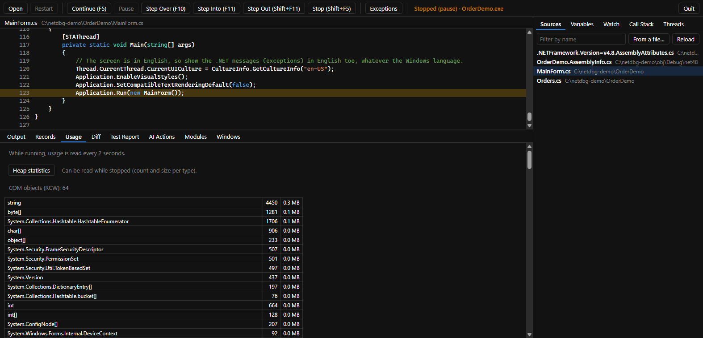

# netdbg 사용 설명서

[English](usage.md) · [日本語](usage.jp.md) · [简体中文](usage.zh-CN.md) · [繁體中文](usage.zh-TW.md) · 한국어 · [README](../README.ko.md)

> 이 문서는 AI가 기계 번역한 것입니다. 잘못된 곳이 있으면 Issue나 Pull Request로 알려 주십시오.

이 설명서는 netdbg의 사용법을 전용 화면(`--ui`), MCP로 쓰는 AI 클라이언트, DAP로 쓰는 편집기 순서로 설명합니다. 그림은 [`samples/OrderDemo`](../samples/OrderDemo)의 예제 프로그램(.NET Framework 4.8, x86의 작은 WinForms 주문 화면)을 디버깅하며 찍은 것입니다. 그림 속 화면은 영어이며, 화면은 Windows의 표시 언어에 따라 한국어로 표시됩니다. 아래의 단추 이름은 한국어 화면의 이름입니다.

- [시작하기](#시작하기)
- [전용 화면(`--ui`)](#전용-화면--ui)
- [중단점, 단계 실행, 식](#중단점-단계-실행-식)
- [PDB 없는 프로그램](#pdb-없는-프로그램)
- [실행 중 기록](#실행-중-기록)
- [프로그램의 창](#프로그램의-창)
- [사용량, 힙, 누수](#사용량-힙-누수)
- [커버리지, 테스트 보고서, 다시 실행](#커버리지-테스트-보고서-다시-실행)
- [편집하며 계속하기](#편집하며-계속하기)
- [AI에서 사용하기(MCP)](#ai에서-사용하기mcp)
- [편집기에서 사용하기(DAP)](#편집기에서-사용하기dap)
- [명령줄](#명령줄)
- [제한과 문제 해결](#제한과-문제-해결)

## 시작하기

1. 엔진을 빌드합니다([README](../README.ko.md#빌드) 참고). `dist\x86\netdbg.exe`와 `dist\x64\netdbg.exe`가 만들어집니다. 두 폴더는 나란히 두십시오. 전용 화면은 비트 수가 다른 프로그램을 다른 쪽 엔진에 맡깁니다.
2. 예제 프로그램을 빌드합니다.

   ```powershell
   dotnet build samples\OrderDemo -c Debug -o C:\netdbg-demo\app
   ```

3. 전용 화면으로 엽니다.

   ```powershell
   dist\x86\netdbg.exe --ui C:\netdbg-demo\app\OrderDemo.exe
   ```

   브라우저에 화면이 열리고 프로그램이 시작됩니다. 프로그램을 지정하지 않은 `netdbg --ui`는 빈 화면을 엽니다. "열기"로 시작하거나 연결하십시오.

예제의 합계는 3개 이상인 줄에 10%의 묶음 할인을 적용합니다. 그래서 차 3잔(각 380)의 합계는 1,140이 아니라 1,026입니다. 아래 그림은 이 흐름으로 찍었습니다.

## 전용 화면(`--ui`)


- **도구 모음**: 열기, 다시 시작, 계속(F5), 일시 중지, 프로시저 단위 실행(F10), 한 단계씩 코드 실행(F11), 프로시저 나가기(Shift+F11), 중지(Shift+F5), 예외(어떤 예외에서 중지할지), 종료. 상태에는 프로그램이 무엇을 하고 있는지 표시됩니다.
- **소스**(가운데): 줄 번호를 클릭하면 중단점을 두거나 뺍니다. 중지되면 현재 줄에 표시가 붙고, 현재 메서드에서 실행된 줄에는 변수의 값이 `//` 뒤에 붙습니다. 이름에 마우스를 올리면 그 값이 표시됩니다(개체는 한 단계 펼쳐서 보여 줍니다).
- **오른쪽**: 소스(프로그램의 소스 목록. 이름으로 필터하거나 파일에서 열 수 있습니다), 변수, 조사식, 호출 스택, 스레드.
- **아래**: 출력(프로그램의 출력과 식 줄의 결과), 기록, 사용량, 차이, 테스트 보고서, AI 작업, 모듈, 창. 맨 아래 줄은 현재 프레임에서 C# 식을 계산합니다.

"열기"에는 탭이 두 개 있습니다.

- *프로그램 열기*: exe(또는 .NET 앱의 dll), 인수, "커버리지 수집".
- *프로세스에 연결*: 실행 중인 .NET 또는 .NET Framework 프로세스를 고릅니다. "관찰 전용"은 프로그램의 내용을 전혀 바꾸지 않고 연결합니다([아래](#관찰-전용) 참고).

화면은 `127.0.0.1`에서만 수신하며, URL에 토큰이 들어갑니다. 같은 포트에서 MCP도 제공하므로, 보고 있는 세션을 AI 클라이언트도 조작할 수 있습니다([AI에서 사용하기](#ai에서-사용하기mcp) 참고).

## 중단점, 단계 실행, 식


- 줄 중단점은 화면, DAP(`setBreakpoints`. 조건, 적중 횟수, 로그 메시지), MCP(`breakpoint_set`. 메서드 이름으로도, 추적점으로도)로 둘 수 있습니다.
- 예외: 중지하지 않음(처리되지 않은 예외만), 사용자 코드에서 처리되지 않을 때, 모든 throw, 형식별 중에서 고릅니다("예외").
- async 메서드의 단계 실행은 await를 넘어 진행합니다. 다음 문 설정은 DAP(`goto`)로 할 수 있습니다.
- 식은 C# 컴파일러와 같은 값과 형식으로 계산합니다. 연산자와 변환, 캐스트, 메서드와 속성 호출, 인덱서, 람다 식과 LINQ(`Lines.Where(l => l.Quantity >= 3).Select(l => l.Product.Name)`), `is`와 `switch` 패턴, 문자열 보간, `dynamic`, 익명 형식, 개체 ID. 메서드와 getter는 프로그램 안에서 실행됩니다.
- 변수에서 개체 옆의 "경로"는 그 개체가 아직 살아 있는 이유를 찾습니다([보존 경로](#사용량-힙-누수) 참고).

## PDB 없는 프로그램


기호가 없는 모듈은 소스 목록에 "디컴파일하여 열기"와 함께 나열됩니다. 엔진이 시퀀스 포인트가 있는 C#으로 디컴파일하므로, 디컴파일한 소스에서 중단점, 단계 실행, 변수, 커버리지를 쓸 수 있습니다. 파일은 `%LOCALAPPDATA%\netdbg\decompiled`에 캐시됩니다. DAP에서는 `launch` / `attach`의 `decompile`을 `"off"`로 하면 디컴파일하지 않습니다. 명령줄 `netdbg --decompile <dll> <폴더>`는 디버깅하지 않고 C#을 씁니다.

Windows PDB(이전 형식)도 읽습니다. 다른 폴더의 PDB를 찾게 하려면 `NETDBG_SYMBOL_DIRS`에 폴더를 `;`로 구분해 넣으십시오.

## 실행 중 기록


"기록" 탭은 프로그램을 중지하지 않고 일어난 일을 모읍니다. 행을 클릭하면 상세 정보와 프로그램 안의 호출자(소스로 가는 링크)가 표시됩니다.

| 기록 | 기록하는 것 |
|---|---|
| SQL | ADO.NET(Oracle ODP.NET, SqlClient, OleDb, Odbc)으로 실행한 문: 매개 변수 값을 채운 문, 매개 변수, 시간, 실패, 호출자, 반복 횟수(N+1 쿼리의 징후). "SQL 기록"을 켜십시오. |
| 예외 | catch된 것을 포함한 모든 예외와, throw할 때의 호출 스택과 지역 변수. "예외 기록"을 켜십시오. |
| 이벤트 | 어떤 이벤트 처리기가 어떤 컨트롤에서 어떤 순서로 실행되었는지. |
| 대화 상자 | `MessageBox.Show`와 `ShowDialog`(WinForms와 WPF): 텍스트, 제목, 폼 형식, 띄운 코드. |
| 트랜잭션 | 데이터베이스 트랜잭션(SQL 기록과 함께): 열린 채로 남은 것과 그 안의 문. |
| 바인딩 | 프로그램이 삼킨 WinForms 데이터 바인딩 실패. |
| 자식 프로세스 | `Process.Start` 호출: 파일과 인수. DAP의 `childProcesses`로 자식도 디버깅할 수 있습니다. |
| UI 멈춤 | UI 스레드가 2초(기본값) 동안 창 메시지에 응답하지 않으면 그 스레드에서 프로그램을 중지합니다. |
| 환경 | 비트 수, 런타임, 사용자, 컴퓨터, OS, 문화권, 표준 시간대, 명령줄, 연결 문자열(암호는 숨김). |

"SQL에서 중단"과 "대화 상자에서 중단"에 문자를 넣으면, 그 문자를 포함한 문이나 대화 상자 직전에 중지합니다.

## 프로그램의 창


"창" 탭은 프로그램의 창(WinForms와 WPF)을 읽습니다. 종류, 이름, 텍스트가 있는 컨트롤 트리와 창의 스크린샷입니다. 컨트롤을 고르면 스크린샷 위에 테두리가 그려집니다. 스크린샷은 프로그램이 중지된 동안에도 찍을 수 있습니다("응답 없음" 잔상이 아니라 마지막으로 그린 화면). 단추 누르기와 텍스트 입력은 AI 도구(`ui_invoke`, `ui_set_text`, `ui_select`, `ui_toggle`, `ui_keys`, `ui_mouse`)나 기록한 단계의 다시 실행으로 합니다.

## 사용량, 힙, 누수



- "사용량"은 실행 중에 Private Bytes, 작업 집합, CPU, GDI와 USER 개체(할당량 대비), 핸들, 32비트 프로그램이면 주소 공간과 가장 큰 빈 블록을 보여 줍니다(32비트 프로그램의 `OutOfMemoryException`은 대개 가장 큰 빈 블록이 작아졌다는 뜻입니다).
- "힙 통계"(중지된 동안)는 형식별 개수와 크기, 살아 있는 COM 개체(RCW)를 셉니다.
- 변수에서 개체 옆의 "경로"(MCP: `retention_path`)는 GC 루트에서 그 개체까지의 가장 짧은 참조 사슬을 보여 줍니다.
- **데이터 중단점**(MCP: `break_on_write`, DAP: data breakpoints)은 어떤 코드든 개체의 필드에 쓰면 중지합니다. .NET만 됩니다(.NET Framework는 안 됨). x86에서는 감시하는 필드에 네이티브 코드(리플렉션의 첫 `SetValue`, P/Invoke의 되쓰기)가 쓰면 프로그램이 종료됩니다. 감시를 설정할 때 엔진이 이를 알려 줍니다.

## 커버리지, 테스트 보고서, 다시 실행


"열기"에서 "커버리지 수집"을 켭니다(DAP: `coverage`, MCP: `coverage`). 실행된 줄은 ●, 실행되지 않은 줄은 ○, 분기의 일부 방향만 실행된 줄은 ◐가 됩니다(표시에 마우스를 올리면 어느 방향인지 보입니다). 비율은 위쪽과 소스 목록의 파일마다 표시됩니다. "XML 쓰기"는 Cobertura XML을 씁니다(실행이 끝날 때도 씁니다). ReportGenerator, GitHub, Azure Pipelines, GitLab이 읽을 수 있습니다.


"테스트 보고서"는 테스트 항목을 기록합니다. 번호와 항목 이름을 넣고 "시작"을 누른 뒤 프로그램을 조작하고(손으로든 AI로든), "OK로 끝내기"나 "NG로 끝내기"를 누릅니다. 작업마다 작업한 위치의 스크린샷과 작업 후 창의 스크린샷, 그 사이에 바뀐 컨트롤, SQL, 메시지, 예외가 남습니다. "보고서 쓰기"는 Excel 통합 문서와 하나로 완결된 HTML 파일, 그리고 "다시 실행"으로 다시 돌릴 수 있는 `.steps.json`을 씁니다(새 빌드에서 같은 작업을 하는 경우 등). 사내 양식을 템플릿으로 쓸 수도 있습니다("기본 템플릿 내보내기"부터 시작하십시오).

"차이"는 두 빌드(exe, dll, 폴더. 기호 불필요)를 비교해 바뀐 메서드를 나열합니다. 커버리지 XML을 주면 바뀌었지만 실행되지 않은 메서드도 나열합니다. 명령줄로도 할 수 있습니다: `netdbg --diff old.exe new.exe --coverage run.cobertura.xml`.

## 편집하며 계속하기

프로그램이 실행 중이거나 중지된 동안 C# 소스를 고쳐 저장하고 적용합니다(DAP: `netdbg.applyChanges`, MCP: `debug_apply_changes`). 그 컴퓨터에 .NET SDK 9.0.200 이상(차이를 그 Roslyn으로 만듭니다), Debug 빌드, 이식 가능한 PDB가 필요합니다(이전 형식의 .NET Framework 프로젝트도 `<DebugType>portable</DebugType>`이면 됩니다). Windows PDB이면 바꾸는 방법을 안내합니다. 런타임이 적용할 수 없는 편집(메서드 시그니처 변경 등)은 이유와 함께 거부합니다.

## AI에서 사용하기(MCP)


위 그림은 예제 프로그램으로 실제로 실행한 MCP 호출과 응답입니다(맨 위의 요청 문장은 예시입니다). AI가 중단점을 두고, 프로그램 창에 텍스트를 넣고, **Add**를 누르고, 중지된 위치와 값을 읽습니다. 응답을 보면 묶음 할인이 적용되었음을 알 수 있습니다.


AI가 한 일은 "AI 작업" 탭에 인수와 시간과 함께 나열됩니다(오른쪽은 그때의 프로그램 창).

### 연결하는 두 가지 방법

| | 방법 | 적합한 경우 |
|---|---|---|
| AI가 엔진을 실행 | `netdbg.exe --mcp`를 등록합니다. AI가 `debug_launch` / `debug_attach`로 시작하거나 연결합니다. | AI 혼자 디버깅할 때. |
| AI가 사람의 세션에 참여 | 전용 화면(`netdbg --ui`)을 열거나 편집기에서 `--mcp-listen`으로 엔진을 시작하고, `netdbg.exe --mcp-connect`를 등록합니다. 호출할 때마다 가장 새로운 세션에 연결합니다(`--mcp-connect=<PID>`면 그 엔진). | 사람과 AI가 같은 프로그램을 볼 때. |

`--ui`나 `--mcp-listen`으로 시작한 엔진은 연결 주소를 `%LOCALAPPDATA%\netdbg\mcp\<PID>.json`에 씁니다. 전용 화면의 "AI 작업" 탭에도 표시됩니다.

### 등록 방법

Claude Code:

```powershell
claude mcp add --scope user netdbg -- "C:\tools\netdbg\x86\netdbg.exe" --mcp-connect
```

GitHub Copilot CLI: `copilot mcp add netdbg -- "C:\tools\netdbg\x86\netdbg.exe" --mcp-connect`

`mcpServers` JSON으로 설정하는 클라이언트(Claude Desktop, Cursor `~\.cursor\mcp.json`, Gemini CLI `~\.gemini\settings.json`, Windsurf `~\.codeium\windsurf\mcp_config.json`, LM Studio `~\.lmstudio\mcp.json`):

```json
{
  "mcpServers": {
    "netdbg": { "command": "C:\\tools\\netdbg\\x86\\netdbg.exe", "args": ["--mcp-connect"] }
  }
}
```

Codex(`~\.codex\config.toml`):

```toml
[mcp_servers.netdbg]
command = "C:\\tools\\netdbg\\x86\\netdbg.exe"
args = ["--mcp-connect"]
```

AI가 엔진을 직접 실행하게 하려면 `--mcp-connect` 대신 `--mcp`를 쓰십시오.

### 도구

| 분류 | 도구 |
|---|---|
| 세션 | `debug_launch`, `debug_attach`, `debug_open_dump`, `debug_status`, `debug_continue`, `debug_pause`, `debug_step`, `debug_wait_for_stop`, `debug_terminate`, `debug_output` |
| 중단점 | `breakpoint_set`(줄, 메서드, 조건, 추적점), `breakpoint_remove`, `breakpoint_list`, `breakpoint_clear`, `trace_log`, `exception_breakpoints`, `break_on_write`, `sql_break` |
| 조사 | `debug_stop_context`(중지 위치, 주변 소스, 지역 변수, 예외를 한 번에), `stack_trace`, `threads`, `variables`, `evaluate`, `set_variable`, `exception_info`, `source_context`, `modules`, `decompile` |
| 프로그램의 창 | `ui_tree`, `ui_find`, `ui_screenshot`, `ui_invoke`, `ui_set_text`, `ui_select`, `ui_toggle`, `ui_keys`, `ui_mouse`, `ui_window`, `ui_wait_for`, `ui_changes`, `ui_replay` |
| 기록 | `sql_log`, `exception_log`, `event_trace`, `dialog_log`, `binding_log`, `transactions`, `environment`, `ui_freeze` |
| 메모리 | `process_usage`, `retention_path` |
| 테스트 | `coverage`, `assembly_diff`, `test_item`, `test_report` |
| 편집하며 계속하기 | `debug_apply_changes` |

흔한 흐름: `breakpoint_set` → `debug_launch`(또는 세션에 참여) → `ui_set_text` / `ui_invoke`로 재현 → `debug_stop_context` → `evaluate` → `debug_continue`. 프로그램을 실행시키는 호출(`ui_invoke`, `debug_continue`, `debug_step`)은 `waitMs`를 받으며, 그동안 프로그램이 중지하면 중지된 위치를 붙여 일찍 응답합니다. 도구 설명(AI가 읽는 것)은 영어입니다.

## 편집기에서 사용하기(DAP)

DAP 클라이언트라면 엔진을 어댑터로 시작할 수 있습니다(`netdbg.exe` 또는 `netdbg.exe --interpreter=vscode`, 표준 입출력. AI도 참여시키려면 `--mcp-listen`을 더합니다). 인수 이름은 C# 확장의 `launch.json`에 맞췄습니다.

`launch`:

| 인수 | |
|---|---|
| `program` | exe 또는 .NET 앱의 dll(`dotnet`으로 시작합니다). |
| `args`, `cwd`, `env` | 인수, 작업 폴더, 환경 변수(`null`은 그 변수를 지웁니다). |
| `stopAtEntry` | 첫 줄에서 중지합니다. |
| `justMyCode`, `enableStepFiltering` | 기본값 `true`. |
| `expressionEvaluationOptions.allowImplicitFuncEval` | `false`면 변수를 표시할 때 속성의 getter를 실행하지 않습니다. |
| `decompile` | `"off"`면 PDB 없는 모듈을 디컴파일하지 않습니다. |
| `editAndContinue` | 기본값 `true`. |
| `coverage` | `true` 또는 `{ "output": 파일 }` / `{ "folder": 폴더 }`. |
| `sqlLog`, `exceptionLog` | `true` 또는 `{ "enabled", "methods" }` / `{ "enabled", "snapshot" }`. |
| `dialogLog` | 기본으로 기록합니다. `false`로 끕니다. |
| `uiFreeze` | `true` / `false` 또는 `{ "enabled", "thresholdMs" }`. |
| `childProcesses` | `"record"`(기본값), `"follow"`, `"off"`. |
| `dumpPath` | 시작하는 대신 크래시 덤프(전체 메모리)를 엽니다. |

`attach`: `processId`(숫자 또는 문자열), `observeOnly`, 그리고 디버깅 방법의 인수.

엔진 고유의 요청과 이벤트는 `netdbg.*`라는 이름입니다(`netdbg.setSqlLog`, `netdbg.heapStats`, `netdbg.retentionPath`, `netdbg.decompile`, `netdbg.applyChanges` 등). `initialize` 응답의 `netdbgSupports*`로 쓸 수 있는 것을 알립니다. 엔진의 메시지는 DAP `initialize`의 `locale`이 나타내는 언어를 씁니다.

<a id="관찰-전용"></a>
### 관찰 전용

`observeOnly`로 연결하는 것(화면에서는 "관찰 전용")은 디버거가 데이터를 바꾸면 안 되는 공유 테스트 환경을 위한 것입니다. 값 변경, 편집하며 계속하기, 다음 문 설정, 프로그램 함수 실행(식 안의 속성 getter, `ToString`, 메서드 호출), 창 입력을 이유와 함께 거부합니다. 필드, 스택, 기록, 스크린샷은 쓸 수 있습니다.

## 명령줄

```text
netdbg [--interpreter=vscode | --mcp | --mcp-listen | --mcp-connect[=<PID>]] [--log=<file>]
netdbg [--log=<file>] --ui [--no-open] [--attach <PID> | <program> [<arguments>...]]
netdbg --decompile <dll> <dir>
netdbg --diff <old> <new> [--coverage <xml>]
netdbg --version
```

`--no-open`은 브라우저를 열지 않습니다(URL을 출력합니다). `--log`는 DAP 통신과 엔진의 이벤트를 파일에 씁니다. 화면과 메시지의 언어는 Windows의 표시 언어를 따릅니다. `NETDBG_LANG`(`en`, `ja`, `zh-CN`, `zh-TW`, `ko`)으로 고를 수 있습니다.

## 제한과 문제 해결

- **비트 수.** 디버거는 프로그램과 비트 수가 같아야 합니다. `--ui`는 다른 쪽 엔진에 스스로 맡깁니다(`x86`과 `x64`를 나란히 두십시오). DAP와 MCP에서는 맞는 쪽 엔진을 쓰십시오. 맞지 않으면 엔진이 알려 줍니다.
- **.NET Framework 2.0~3.5** 프로그램은 다룰 수 없습니다(4.x만). .NET은 Core 3.0 이상을 다룹니다.
- **데이터 중단점**은 .NET만 됩니다. x86에서는 감시하는 필드에 네이티브 코드가 쓰면 프로그램이 종료됩니다.
- **스크린샷과 입력**에는 프로그램의 데스크톱이 필요합니다. Windows가 잠겨 있는 동안은 쓸 수 없습니다. 동시에 마우스나 키보드를 쓰면 `ui_keys`와 `ui_mouse`가 흐트러질 수 있습니다.
- **편집하며 계속하기**에는 .NET SDK 9.0.200 이상과 이식 가능한 PDB가 필요합니다.
- 이상하다고 생각되면 먼저 `--log=<파일>`을 붙여 요청과 응답을 확인하십시오.
