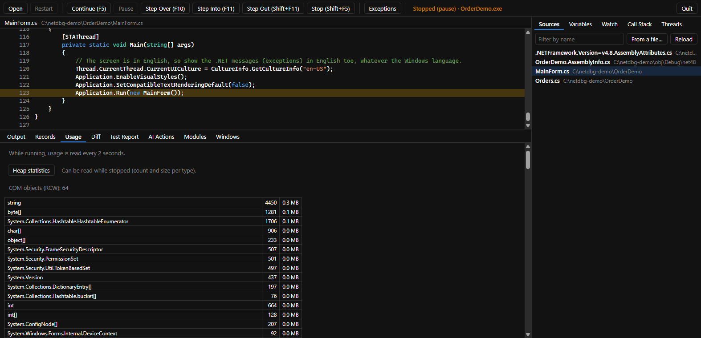
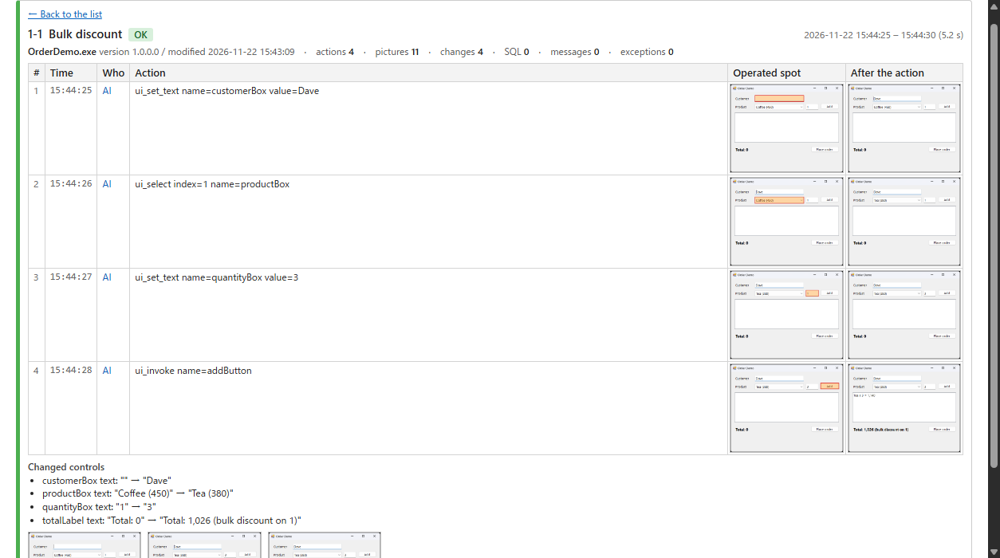

# netdbg usage guide

English · [日本語](usage.jp.md) · [简体中文](usage.zh-CN.md) · [繁體中文](usage.zh-TW.md) · [한국어](usage.ko.md) · [README](../README.md)

This guide shows how to use netdbg: its own screen in the browser (`--ui`), AI clients over MCP, and editors over DAP.
The pictures were taken with the sample program in [`samples/OrderDemo`](../samples/OrderDemo) (a small WinForms order
screen for .NET Framework 4.8, x86).

- [Getting started](#getting-started)
- [The screen (`--ui`)](#the-screen---ui)
- [Breakpoints, stepping and expressions](#breakpoints-stepping-and-expressions)
- [Programs without a PDB](#programs-without-a-pdb)
- [Records while running](#records-while-running)
- [The program's windows](#the-programs-windows)
- [Usage, heap and leaks](#usage-heap-and-leaks)
- [Coverage, test reports and replay](#coverage-test-reports-and-replay)
- [Edit and Continue](#edit-and-continue)
- [AI clients (MCP)](#ai-clients-mcp)
- [Editors (DAP)](#editors-dap)
- [Command line](#command-line)
- [Limits and troubleshooting](#limits-and-troubleshooting)

## Getting started

1. Build the engine (see [README](../README.md#build)). You get `dist\x86\netdbg.exe` and `dist\x64\netdbg.exe`. Keep the
   two folders side by side: the screen hands a program of the other bitness to the other engine.
2. Build the sample:

   ```powershell
   dotnet build samples\OrderDemo -c Debug -o C:\netdbg-demo\app
   ```

3. Open it on the screen:

   ```powershell
   dist\x86\netdbg.exe --ui C:\netdbg-demo\app\OrderDemo.exe
   ```

   The browser opens the screen and the program starts. Without a program, `netdbg --ui` opens an empty screen; use
   **Open** to launch or attach.

The sample's total gives a bulk discount (10 %) to lines of 3 items or more, so three teas (380 each) come to 1,026,
not 1,140. The pictures below follow that.

## The screen (`--ui`)


- **Toolbar**: Open, Restart, Continue (F5), Pause, Step Over (F10), Step Into (F11), Step Out (Shift+F11), Stop
  (Shift+F5), Exceptions (which exceptions stop the program), Quit. The status shows what the program is doing.
- **Source** (middle): click a line number to set or remove a breakpoint. When stopped, the current line is marked and
  the lines already run in the current method show their variables' values after `//`. Point at a name to see its value
  (objects open one level).
- **Right side**: Sources (the program's source files; filter by name, or open one from a file), Variables, Watch,
  Call Stack, Threads.
- **Bottom**: Output (the program's output and the results of the expression line), Records, Usage, Diff, Test Report,
  AI Actions, Modules, Windows. The line at the very bottom evaluates a C# expression in the current frame.

**Open** has two tabs:

- *Open a Program*: the exe (or a .NET app's dll), its arguments, and *Collect coverage*.
- *Attach to a Process*: pick a running .NET or .NET Framework process. *Observe only* attaches without changing
  anything in the program (see [below](#observe-only)).

The screen listens on `127.0.0.1` only, with a token in its URL. The same port also serves MCP, so an AI client can
work with the session you are looking at (see [AI clients](#ai-clients-mcp)).

## Breakpoints, stepping and expressions


- Breakpoints on lines, set on the screen, by DAP (`setBreakpoints`, with condition, hit count and log message) or by
  MCP (`breakpoint_set`, also on a method by name and as a tracepoint).
- Exceptions: stop on none (unhandled ones only), user-unhandled, or every throw, by type too (**Exceptions**).
- Stepping in async methods follows the awaits. Set next statement is available over DAP (`goto`).
- Expressions are evaluated with the values and types the C# compiler gives: operators and conversions, casts, method
  and property calls, indexers, lambdas and LINQ (`Lines.Where(l => l.Quantity >= 3).Select(l => l.Product.Name)`),
  `is` and `switch` patterns, string interpolation, `dynamic`, anonymous types, object IDs. Methods and getters run in
  the program.
- Variables show `Path` next to objects: it finds why the object is still alive (see
  [retention path](#usage-heap-and-leaks)).

## Programs without a PDB


When a module of the program has no symbols, it is listed under Sources with **Decompile and open**. The engine
decompiles it to C# with sequence points, so breakpoints, stepping, variables and coverage work on the decompiled source.
The files are cached under `%LOCALAPPDATA%\netdbg\decompiled`. Over DAP, `decompile` in `launch` / `attach` turns it
off with `"off"`; the command line `netdbg --decompile <dll> <folder>` writes the C# without debugging.

Windows PDBs (the older format) are read as well. To find PDBs in other folders, set `NETDBG_SYMBOL_DIRS` (folders
separated by `;`).

## Records while running


The **Records** tab collects what happened without stopping the program. Click a row for its details and the caller in
the program (a link to the source).

| Record | What is recorded |
|---|---|
| SQL | Statements run through ADO.NET (Oracle ODP.NET, SqlClient, OleDb, Odbc): the statement with the parameter values filled in, the parameters, duration, failure, caller, and repeats (a sign of N+1 queries). Turn on *Record SQL*. |
| Exceptions | Every exception thrown, also caught ones, with the call stack and the locals at the throw. Turn on *Record exceptions*. |
| Events | Which event handlers ran, from which control, in order. |
| Dialogs | `MessageBox.Show` and `ShowDialog` (WinForms and WPF): text, caption, form type, the code that showed it. |
| Transactions | Database transactions (with the SQL log): those left open and the statements in them. |
| Bindings | WinForms data binding failures that the program swallowed. |
| Child processes | `Process.Start` calls: file and arguments. Over DAP, `childProcesses` can also follow them. |
| UI freezes | A UI thread that does not answer window messages for 2 seconds (by default) pauses the program on that thread. |
| Environment | Bitness, runtime, user, machine, OS, culture, time zone, command line, connection strings (passwords hidden). |

*Break on SQL* and *Break on dialogs* stop the program right before a statement or dialog whose text contains the
given words.

## The program's windows


**Windows** reads the program's windows (WinForms and WPF): the control tree with kinds, names and texts, and a picture
of the window. Selecting a control frames it on the picture. The picture is taken also while the program is stopped
(its last drawing, not the "Not Responding" ghost). Pressing buttons and typing is done by the AI tools (`ui_invoke`,
`ui_set_text`, `ui_select`, `ui_toggle`, `ui_keys`, `ui_mouse`) or by replaying recorded steps.

## Usage, heap and leaks



- **Usage** shows, while running, private bytes, working set, CPU, GDI and USER objects against their quotas, handles,
  and for a 32-bit program its address space and largest free block (an `OutOfMemoryException` in a 32-bit program
  usually means the largest free block got small).
- **Heap statistics** (while stopped) counts objects and sizes per type, and the COM objects (RCWs) alive.
- **Path** next to an object in Variables (MCP: `retention_path`) gives the shortest chain of references from a GC root
  to that object.
- **Data breakpoints** (MCP: `break_on_write`; DAP: data breakpoints) stop when a field of an object is written by any
  code. .NET only (not .NET Framework). On x86, a write from native code to the watched field (reflection's first
  `SetValue`, P/Invoke writing back) ends the program; the engine says so when the watch is set.

## Coverage, test reports and replay


Turn on *Collect coverage* in **Open** (DAP: `coverage`; MCP: `coverage`). Lines that ran get ●, lines that did not ○,
and branches where only some ways ran ◐ (point at the mark to see which). The rates are shown at the top, per file in
Sources, and **Write XML** writes Cobertura XML (also at the end of the run), which ReportGenerator, GitHub, Azure
Pipelines and GitLab read.



**Test Report** records test items: enter a number and a title, **Start**, operate the program (by hand or by AI), then
**End as OK** or **End as NG**. Each action is recorded with a picture of the operated spot and of the window after it,
with the controls that changed, the SQL, messages and exceptions in between. **Write the report** writes an Excel
workbook and one self-contained HTML file, plus a `.steps.json` that **Replay** runs again (on a newer build, for
example). A site's own layout can be used as templates (**Export the default templates** to start from).

**Diff** compares two builds (exe, dll or folders; no symbols needed) and lists the methods that changed; with a
coverage XML it also lists the changed methods that were not run. The command line does the same:
`netdbg --diff old.exe new.exe --coverage run.cobertura.xml`.

## Edit and Continue

Change the C# source while the program runs or is stopped, save, and apply (DAP: `netdbg.applyChanges`; MCP:
`debug_apply_changes`). It needs a .NET SDK 9.0.200 or later on the machine (the deltas are made with its Roslyn), a Debug
build, and portable PDBs (also for old-style .NET Framework projects with `<DebugType>portable</DebugType>`). With a
Windows PDB, the engine tells you how to switch. Edits that the runtime cannot apply (for example changing a
method's signature) are refused with the reason.

## AI clients (MCP)


The picture above lists real MCP calls and answers made with the sample (the request at the top is an example). The AI
sets a breakpoint, types into the program's window, presses **Add**, and reads where it stopped and the values; the
answers show that the bulk discount was applied.


Everything the AI does is listed in **AI Actions** with its arguments and time, next to the program's window.

### Two ways to connect

| | How | When |
|---|---|---|
| The AI runs the engine | Register `netdbg.exe --mcp`. The AI launches or attaches with `debug_launch` / `debug_attach`. | The AI debugs alone. |
| The AI joins your session | Open the screen (`netdbg --ui`) or start the engine from the editor with `--mcp-listen`, and register `netdbg.exe --mcp-connect`. At each call it connects to the latest session (or a given engine with `--mcp-connect=<PID>`). | You and the AI look at the same program. |

The engines started with `--ui` or `--mcp-listen` write their address to `%LOCALAPPDATA%\netdbg\mcp\<PID>.json`; the
screen's **AI Actions** tab also shows it.

### Registering

Claude Code:

```powershell
claude mcp add --scope user netdbg -- "C:\tools\netdbg\x86\netdbg.exe" --mcp-connect
```

GitHub Copilot CLI: `copilot mcp add netdbg -- "C:\tools\netdbg\x86\netdbg.exe" --mcp-connect`.

Clients configured with an `mcpServers` JSON (Claude Desktop, Cursor `~\.cursor\mcp.json`, Gemini CLI
`~\.gemini\settings.json`, Windsurf `~\.codeium\windsurf\mcp_config.json`, LM Studio `~\.lmstudio\mcp.json`):

```json
{
  "mcpServers": {
    "netdbg": { "command": "C:\\tools\\netdbg\\x86\\netdbg.exe", "args": ["--mcp-connect"] }
  }
}
```

Codex (`~\.codex\config.toml`):

```toml
[mcp_servers.netdbg]
command = "C:\\tools\\netdbg\\x86\\netdbg.exe"
args = ["--mcp-connect"]
```

Use `--mcp` instead of `--mcp-connect` for the AI to run the engine itself.

### Tools

| Group | Tools |
|---|---|
| Session | `debug_launch`, `debug_attach`, `debug_open_dump`, `debug_status`, `debug_continue`, `debug_pause`, `debug_step`, `debug_wait_for_stop`, `debug_terminate`, `debug_output` |
| Breakpoints | `breakpoint_set` (line, method, condition, tracepoint), `breakpoint_remove`, `breakpoint_list`, `breakpoint_clear`, `trace_log`, `exception_breakpoints`, `break_on_write`, `sql_break` |
| Inspecting | `debug_stop_context` (where, source around it, locals, exception, in one call), `stack_trace`, `threads`, `variables`, `evaluate`, `set_variable`, `exception_info`, `source_context`, `modules`, `decompile` |
| The program's windows | `ui_tree`, `ui_find`, `ui_screenshot`, `ui_invoke`, `ui_set_text`, `ui_select`, `ui_toggle`, `ui_keys`, `ui_mouse`, `ui_window`, `ui_wait_for`, `ui_changes`, `ui_replay` |
| Records | `sql_log`, `exception_log`, `event_trace`, `dialog_log`, `binding_log`, `transactions`, `environment`, `ui_freeze` |
| Memory | `process_usage`, `retention_path` |
| Tests | `coverage`, `assembly_diff`, `test_item`, `test_report` |
| Edit and Continue | `debug_apply_changes` |

A typical flow: `breakpoint_set` → `debug_launch` (or join a session) → `ui_set_text` / `ui_invoke` to reproduce →
`debug_stop_context` → `evaluate` → `debug_continue`. Calls that make the program run (`ui_invoke`, `debug_continue`,
`debug_step`) take `waitMs` and answer early when the program stops, with where it stopped.

## Editors (DAP)

Any DAP client can start the engine as its adapter (`netdbg.exe`, or `netdbg.exe --interpreter=vscode`, over standard
input and output; add `--mcp-listen` to let an AI join). The arguments follow the C# extension's `launch.json` names.

`launch`:

| Argument | |
|---|---|
| `program` | The exe, or a .NET app's dll (then started with `dotnet`). |
| `args`, `cwd`, `env` | Arguments, working folder, environment (`null` removes a variable). |
| `stopAtEntry` | Stop at the first line. |
| `justMyCode`, `enableStepFiltering` | Default `true`. |
| `expressionEvaluationOptions.allowImplicitFuncEval` | `false`: property getters are not run when variables are shown. |
| `decompile` | `"off"` to not decompile modules without a PDB. |
| `editAndContinue` | Default `true`. |
| `coverage` | `true`, or `{ "output": file }` / `{ "folder": folder }`. |
| `sqlLog`, `exceptionLog` | `true`, or `{ "enabled", "methods" }` / `{ "enabled", "snapshot" }`. |
| `dialogLog` | Default on; `false` to turn off. |
| `uiFreeze` | `true` / `false`, or `{ "enabled", "thresholdMs" }`. |
| `childProcesses` | `"record"` (default), `"follow"` or `"off"`. |
| `dumpPath` | Open a crash dump (full memory) instead of launching. |

`attach`: `processId` (a number or a string), `observeOnly`, and the same debugging options.

The engine also answers its own requests and sends its own events, named `netdbg.*` (for example `netdbg.setSqlLog`,
`netdbg.heapStats`, `netdbg.retentionPath`, `netdbg.decompile`, `netdbg.applyChanges`), announced with
`netdbgSupports*` capabilities in the `initialize` response.

<a id="observe-only"></a>
### Observe only

Attaching with `observeOnly` (the screen: *Observe only*) is for shared test environments where the debugger must not
change data. Changing values, Edit and Continue, set next statement, running the program's functions (property getters,
`ToString`, method calls in expressions) and input to its windows are refused with the reason. Fields, stacks,
records and pictures still work.

## Command line

```text
netdbg [--interpreter=vscode | --mcp | --mcp-listen | --mcp-connect[=<PID>]] [--log=<file>]
netdbg [--log=<file>] --ui [--no-open] [--attach <PID> | <program> [<arguments>...]]
netdbg --decompile <dll> <dir>
netdbg --diff <old> <new> [--coverage <xml>]
netdbg --version
```

`--no-open` does not open the browser (the URL is printed). `--log` writes the DAP traffic and the engine's events to a
file. The language of the screen and the messages follows Windows (English, Japanese, Simplified and Traditional Chinese, Korean); set `NETDBG_LANG` (`en`, `ja`, `zh-CN`, `zh-TW`, `ko`) to choose. With DAP, the `locale` of `initialize` chooses it.

## Limits and troubleshooting

- **Bitness.** A debugger must have the bitness of the program. `--ui` hands the program to the other engine by itself
  (keep `x86` and `x64` side by side). Over DAP and MCP, use the engine that matches; it tells you when it does not.
- **.NET Framework 2.0 to 3.5** programs are refused (4.x only). .NET Core 3.0 and later are supported.
- **Data breakpoints** are .NET only; on x86, writes from native code to the watched field crash the program.
- **Pictures and input** need the program's desktop: they do not work while Windows is locked, and input from the mouse
  and keyboard at the same time can disturb `ui_keys` and `ui_mouse`.
- **Edit and Continue** needs a .NET SDK 9.0.200 or later and portable PDBs.
- When something looks wrong, start with `--log=<file>` and look at the requests and answers.
