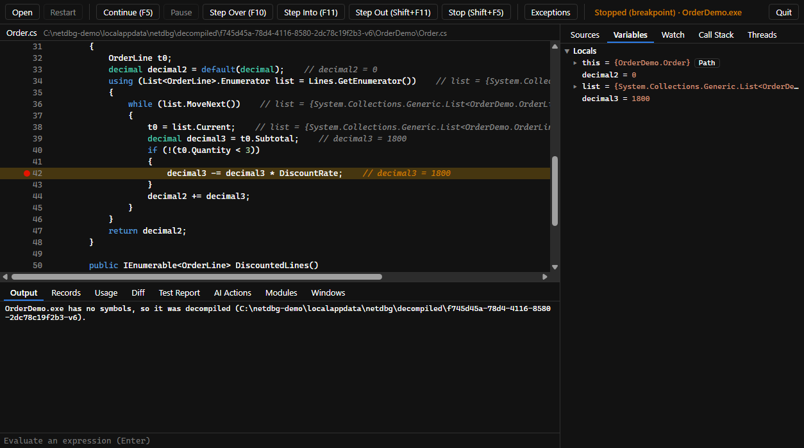
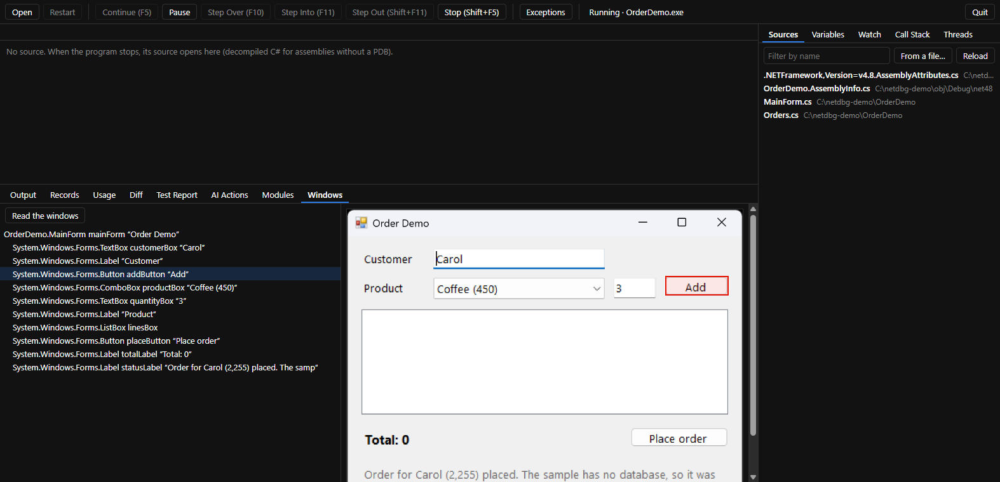
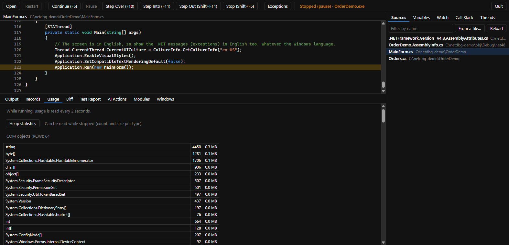

# netdbg 使用指南

[English](usage.md) · [日本語](usage.jp.md) · 简体中文 · [繁體中文](usage.zh-TW.md) · [한국어](usage.ko.md) · [README](../README.zh-CN.md)

> 本文档由 AI 机器翻译。如有错误，欢迎通过 Issue 或 Pull Request 指正。

本指南介绍 netdbg 的用法：浏览器中的专用界面（`--ui`）、通过 MCP 使用的 AI 客户端，以及通过 DAP 使用的编辑器。图片是调试 [`samples/OrderDemo`](../samples/OrderDemo) 中的示例程序（.NET Framework 4.8、x86 的小型 WinForms 订单界面）时截取的。截图中的界面为英文；界面会按 Windows 的显示语言以简体中文显示，下文中的按钮名称使用简体中文界面上的名称。

- [入门](#入门)
- [界面（`--ui`）](#界面--ui)
- [断点、单步执行和表达式](#断点单步执行和表达式)
- [没有 PDB 的程序](#没有-pdb-的程序)
- [运行时的记录](#运行时的记录)
- [程序的窗口](#程序的窗口)
- [使用情况、堆和泄漏](#使用情况堆和泄漏)
- [覆盖率、测试报告和重放](#覆盖率测试报告和重放)
- [编辑并继续](#编辑并继续)
- [从 AI 使用（MCP）](#从-ai-使用mcp)
- [从编辑器使用（DAP）](#从编辑器使用dap)
- [命令行](#命令行)
- [限制和故障排除](#限制和故障排除)

## 入门

1. 生成引擎（请参阅 [README](../README.zh-CN.md#生成)）。会得到 `dist\x86\netdbg.exe` 和 `dist\x64\netdbg.exe`。请让这两个文件夹保持并列：界面会把位数不同的程序交给另一个引擎。
2. 生成示例程序：

   ```powershell
   dotnet build samples\OrderDemo -c Debug -o C:\netdbg-demo\app
   ```

3. 在界面中打开它：

   ```powershell
   dist\x86\netdbg.exe --ui C:\netdbg-demo\app\OrderDemo.exe
   ```

   浏览器会打开界面，程序随即启动。不指定程序时，`netdbg --ui` 会打开一个空界面；请用“打开”来启动或附加。

示例程序的合计会对 3 个及以上的行给予 10% 的批量折扣，因此 3 杯茶（每杯 380）的合计是 1,026，而不是 1,140。下面的图片就是按这个流程截取的。

## 界面（`--ui`）


- **工具栏**：打开、重新启动、继续 (F5)、暂停、逐过程 (F10)、逐语句 (F11)、跳出 (Shift+F11)、停止 (Shift+F5)、异常（在哪些异常处停止）、退出。状态显示程序正在做什么。
- **源文件**（中间）：单击行号可设置或删除断点。停止时，当前行会被标出，当前方法中已运行的行会在 `//` 之后显示变量的值。将鼠标指向名称可查看其值（对象展开一层）。
- **右侧**：源文件（程序的源文件；可按名称筛选，或从文件打开）、变量、监视、调用堆栈、线程。
- **底部**：输出（程序的输出和表达式行的结果）、记录、使用情况、差异、测试报告、AI 操作、模块、窗口。最底部的行在当前帧中计算 C# 表达式。

“打开”有两个选项卡：

- *打开程序*：exe（或 .NET 应用的 dll）、其参数，以及“收集覆盖率”。
- *附加到进程*：选择正在运行的 .NET 或 .NET Framework 进程。“仅观察”会在不更改程序中任何内容的情况下附加（请参阅[下文](#仅观察)）。

界面只在 `127.0.0.1` 上侦听，URL 中带有令牌。同一端口也提供 MCP，因此 AI 客户端可以操作您正在查看的会话（请参阅[从 AI 使用](#从-ai-使用mcp)）。

## 断点、单步执行和表达式


- 行断点可以在界面上设置，也可以通过 DAP（`setBreakpoints`，带条件、命中次数和日志消息）或 MCP（`breakpoint_set`，也可以按方法名称设置，或作为跟踪点）设置。
- 异常：可以选择不停止（仅未处理的异常）、用户代码未处理时停止或每次引发时都停止，也可以按类型选择（“异常”）。
- 在 async 方法中单步执行时会跨越 await。设置下一条语句可以通过 DAP（`goto`）进行。
- 表达式按照 C# 编译器给出的值和类型计算：运算符和转换、强制转换、方法和属性调用、索引器、lambda 和 LINQ（`Lines.Where(l => l.Quantity >= 3).Select(l => l.Product.Name)`）、`is` 和 `switch` 模式、字符串内插、`dynamic`、匿名类型、对象 ID。方法和 getter 在程序中运行。
- 变量中对象旁边的“路径”可以查找该对象仍然存活的原因（请参阅[保留路径](#使用情况堆和泄漏)）。

## 没有 PDB 的程序



程序中没有符号的模块会在“源文件”中带“反编译并打开”列出。引擎会将其反编译为带序列点的 C#，因此断点、单步执行、变量和覆盖率都可以在反编译的源文件上使用。文件缓存在 `%LOCALAPPDATA%\netdbg\decompiled` 下。通过 DAP 时，将 `launch` / `attach` 的 `decompile` 设为 `"off"` 即可关闭；命令行 `netdbg --decompile <dll> <文件夹>` 会在不调试的情况下写出 C#。

也能读取 Windows PDB（旧格式）。要在其他文件夹中查找 PDB，请设置 `NETDBG_SYMBOL_DIRS`（文件夹用 `;` 分隔）。

## 运行时的记录


“记录”选项卡在不停止程序的情况下收集发生的事情。单击某一行可查看其详细信息和程序中的调用方（指向源文件的链接）。

| 记录 | 记录的内容 |
|---|---|
| SQL | 通过 ADO.NET（Oracle ODP.NET、SqlClient、OleDb、Odbc）运行的语句：填入参数值的语句、参数、用时、失败、调用方和重复次数（N+1 查询的迹象）。请打开“记录 SQL”。 |
| 异常 | 引发的所有异常（包括已捕获的），以及引发时的调用堆栈和局部变量。请打开“记录异常”。 |
| 事件 | 哪些事件处理程序、从哪个控件、按什么顺序运行。 |
| 对话框 | `MessageBox.Show` 和 `ShowDialog`（WinForms 和 WPF）：文本、标题、窗体类型、显示它的代码。 |
| 事务 | 数据库事务（与 SQL 记录一起）：未关闭的事务及其中的语句。 |
| 绑定 | 程序吞掉的 WinForms 数据绑定失败。 |
| 子进程 | `Process.Start` 的调用：文件和参数。通过 DAP 的 `childProcesses` 也可以调试子进程。 |
| 界面冻结 | UI 线程在 2 秒（默认）内不响应窗口消息时，会在该线程上暂停程序。 |
| 环境 | 位数、运行时、用户、计算机、OS、区域性、时区、命令行、连接字符串（密码会隐藏）。 |

在“在 SQL 处中断”和“在对话框处中断”中输入文字，程序会在包含这些文字的语句或对话框之前停止。

## 程序的窗口



“窗口”读取程序的窗口（WinForms 和 WPF）：包含类型、名称和文本的控件树，以及窗口的截图。选择控件后会在截图上框出它。程序停止时也可以截图（是最后一次绘制的画面，而不是“未响应”的残影）。按按钮和输入文本由 AI 工具（`ui_invoke`、`ui_set_text`、`ui_select`、`ui_toggle`、`ui_keys`、`ui_mouse`）完成，或通过重放记录的步骤完成。

## 使用情况、堆和泄漏



- “使用情况”在运行时显示专用字节、工作集、CPU、GDI 和 USER 对象（相对于其配额）、句柄；对于 32 位程序，还显示其地址空间和最大空闲块（32 位程序中的 `OutOfMemoryException` 通常意味着最大空闲块变小了）。
- “堆统计”（停止时）按类型统计对象的数量和大小，以及存活的 COM 对象（RCW）。
- 变量中对象旁边的“路径”（MCP：`retention_path`）给出从 GC 根到该对象的最短引用链。
- **数据断点**（MCP：`break_on_write`；DAP：data breakpoints）在任何代码写入对象的字段时停止。仅限 .NET（不支持 .NET Framework）。在 x86 上，如果本机代码（反射的首次 `SetValue`、P/Invoke 的回写）写入被监视的字段，程序会结束；设置监视时引擎会告知这一点。

## 覆盖率、测试报告和重放


在“打开”中打开“收集覆盖率”（DAP：`coverage`；MCP：`coverage`）。已运行的行标记为 ●，未运行的行标记为 ○，只走过部分方向的分支标记为 ◐（将鼠标指向标记可查看是哪个方向）。比率显示在顶部和“源文件”中的每个文件旁；“写入 XML”会写出 Cobertura XML，并把其中的全部源文件收成旁边的一个 HTML（`*.coverage.html`，运行结束时也会写出），ReportGenerator、GitHub、Azure Pipelines 和 GitLab 都能读取该 XML。


“测试报告”记录测试项目：输入编号和标题，按“开始”，操作程序（手动或由 AI），然后按“以 OK 结束”或“以 NG 结束”。每个操作都会记录一张标出操作位置的截图和一张操作后窗口的截图，以及其间更改的控件、SQL、消息和异常。“写出报告”会写出 Excel 工作簿和一个独立的 HTML 文件，以及可用“重放”再次运行的 `.steps.json`（例如在新的生成上）。也可以使用贵单位自己的格式作为模板（从“导出默认模板”开始）。

“差异”比较两次生成（exe、dll 或文件夹；不需要符号）并列出更改的方法；指定覆盖率 XML 时，还会列出已更改但未运行的方法。命令行也可以做同样的事：`netdbg --diff old.exe new.exe --coverage run.cobertura.xml`。

## 编辑并继续

在程序运行或停止时修改 C# 源代码，保存并应用（DAP：`netdbg.applyChanges`；MCP：`debug_apply_changes`）。需要计算机上有 .NET SDK 9.0.200 或更高版本（差异由其 Roslyn 生成）、Debug 生成以及可移植 PDB（旧式 .NET Framework 项目只要使用 `<DebugType>portable</DebugType>` 也可以）。使用 Windows PDB 时，引擎会告诉您如何切换。运行时无法应用的编辑（例如更改方法的签名）会连同原因一起被拒绝。

## 从 AI 使用（MCP）


上图列出了用示例程序实际进行的 MCP 调用和应答（顶部的请求是示例）。AI 设置断点，在程序的窗口中输入文本，按 **Add**，然后读取停止的位置和值；应答表明批量折扣已生效。


AI 所做的一切都会连同参数和时间列在“AI 操作”中，旁边是程序的窗口。

### 两种连接方式

| | 方法 | 适用场景 |
|---|---|---|
| AI 运行引擎 | 注册 `netdbg.exe --mcp`。AI 用 `debug_launch` / `debug_attach` 启动或附加。 | AI 单独调试。 |
| AI 加入您的会话 | 打开界面（`netdbg --ui`），或从编辑器用 `--mcp-listen` 启动引擎，然后注册 `netdbg.exe --mcp-connect`。每次调用时它都会连接到最新的会话（或用 `--mcp-connect=<PID>` 指定的引擎）。 | 您和 AI 查看同一个程序。 |

用 `--ui` 或 `--mcp-listen` 启动的引擎会将其地址写入 `%LOCALAPPDATA%\netdbg\mcp\<PID>.json`；界面的“AI 操作”选项卡中也会显示。

### 注册

Claude Code：

```powershell
claude mcp add --scope user netdbg -- "C:\tools\netdbg\x86\netdbg.exe" --mcp-connect
```

GitHub Copilot CLI：`copilot mcp add netdbg -- "C:\tools\netdbg\x86\netdbg.exe" --mcp-connect`。

用 `mcpServers` JSON 配置的客户端（Claude Desktop、Cursor `~\.cursor\mcp.json`、Gemini CLI `~\.gemini\settings.json`、Windsurf `~\.codeium\windsurf\mcp_config.json`、LM Studio `~\.lmstudio\mcp.json`）：

```json
{
  "mcpServers": {
    "netdbg": { "command": "C:\\tools\\netdbg\\x86\\netdbg.exe", "args": ["--mcp-connect"] }
  }
}
```

Codex（`~\.codex\config.toml`）：

```toml
[mcp_servers.netdbg]
command = "C:\\tools\\netdbg\\x86\\netdbg.exe"
args = ["--mcp-connect"]
```

要让 AI 自己运行引擎，请按位数用 `--mcp` 注册。使用与目标相同位数的服务器。exe 旁边需要相同位数的 `dbgshim.dll` 和 `encdelta`。

```json
{
  "mcpServers": {
    "netdbg-x86": { "command": "C:\\tools\\netdbg\\x86\\netdbg.exe", "args": ["--mcp"] },
    "netdbg-x64": { "command": "C:\\tools\\netdbg\\x64\\netdbg.exe", "args": ["--mcp"] }
  }
}
```

### 工具

| 分组 | 工具 |
|---|---|
| 会话 | `debug_launch`、`debug_attach`、`debug_open_dump`、`debug_status`、`debug_continue`、`debug_pause`、`debug_step`、`debug_wait_for_stop`、`debug_terminate`、`debug_output` |
| 断点 | `breakpoint_set`（行、方法、条件、跟踪点）、`breakpoint_remove`、`breakpoint_list`、`breakpoint_clear`、`trace_log`、`exception_breakpoints`、`break_on_write`、`sql_break` |
| 检查 | `debug_stop_context`（一次调用即可得到停止位置、周围的源代码、局部变量和异常）、`stack_trace`、`threads`、`variables`、`evaluate`、`set_variable`、`exception_info`、`source_context`、`modules`、`decompile` |
| 程序的窗口 | `ui_tree`、`ui_find`、`ui_screenshot`、`ui_invoke`、`ui_set_text`、`ui_select`、`ui_toggle`、`ui_keys`、`ui_mouse`、`ui_window`、`ui_wait_for`、`ui_changes`、`ui_replay` |
| 记录 | `sql_log`、`exception_log`、`event_trace`、`dialog_log`、`binding_log`、`transactions`、`environment`、`ui_freeze` |
| 内存 | `process_usage`、`retention_path` |
| 测试 | `coverage`、`assembly_diff`、`test_item`、`test_report` |
| 编辑并继续 | `debug_apply_changes` |

典型流程：`breakpoint_set` → `debug_launch`（或加入会话）→ 用 `ui_set_text` / `ui_invoke` 重现 → `debug_stop_context` → `evaluate` → `debug_continue`。使程序运行的调用（`ui_invoke`、`debug_continue`、`debug_step`）接受 `waitMs`，程序停止时会提前应答并告知停止的位置。工具的说明（供 AI 阅读）为英文。

## 从编辑器使用（DAP）

任何 DAP 客户端都可以将引擎作为其适配器启动（`netdbg.exe` 或 `netdbg.exe --interpreter=vscode`，通过标准输入和输出；加上 `--mcp-listen` 可让 AI 加入）。参数名称沿用 C# 扩展 `launch.json` 的名称。

`launch`：

| 参数 | |
|---|---|
| `program` | exe，或 .NET 应用的 dll（此时用 `dotnet` 启动）。 |
| `args`、`cwd`、`env` | 参数、工作文件夹、环境变量（`null` 删除该变量）。 |
| `stopAtEntry` | 在第一行停止。 |
| `justMyCode`、`enableStepFiltering` | 默认为 `true`。 |
| `expressionEvaluationOptions.allowImplicitFuncEval` | `false`：显示变量时不运行属性的 getter。 |
| `decompile` | `"off"`：不反编译没有 PDB 的模块。 |
| `editAndContinue` | 默认为 `true`。 |
| `coverage` | `true`，或 `{ "output": 文件 }` / `{ "folder": 文件夹 }`。 |
| `sqlLog`、`exceptionLog` | `true`，或 `{ "enabled", "methods" }` / `{ "enabled", "snapshot" }`。 |
| `dialogLog` | 默认记录；`false` 关闭。 |
| `uiFreeze` | `true` / `false`，或 `{ "enabled", "thresholdMs" }`。 |
| `childProcesses` | `"record"`（默认）、`"follow"` 或 `"off"`。 |
| `dumpPath` | 不启动程序，而是打开故障转储（完整内存）。 |

`attach`：`processId`（数字或字符串）、`observeOnly`，以及相同的调试选项。

引擎还会响应自己的请求并发送自己的事件，名称为 `netdbg.*`（例如 `netdbg.setSqlLog`、`netdbg.heapStats`、`netdbg.retentionPath`、`netdbg.decompile`、`netdbg.applyChanges`），并在 `initialize` 的应答中以 `netdbgSupports*` 功能告知。引擎的消息使用 DAP `initialize` 的 `locale` 所示的语言。

<a id="仅观察"></a>
### 仅观察

用 `observeOnly` 附加（界面上为“仅观察”）适用于调试器不得更改数据的共享测试环境。更改值、编辑并继续、设置下一条语句、运行程序的函数（表达式中的属性 getter、`ToString`、方法调用）以及向其窗口输入都会连同原因一起被拒绝。字段、堆栈、记录和截图仍然可以使用。

## 命令行

```text
netdbg [--interpreter=vscode | --mcp | --mcp-listen | --mcp-connect[=<PID>]] [--log=<file>]
netdbg [--log=<file>] --ui [--no-open] [--attach <PID> | <program> [<arguments>...]]
netdbg --decompile <dll> <dir>
netdbg --diff <old> <new> [--coverage <xml>]
netdbg --version
```

`--no-open` 不打开浏览器（会输出 URL）。`--log` 将 DAP 通信和引擎的事件写入文件。界面和消息的语言跟随 Windows 的显示语言；可以用 `NETDBG_LANG`（`en`、`ja`、`zh-CN`、`zh-TW`、`ko`）指定。

## 限制和故障排除

- **位数。** 调试器必须与程序的位数相同。`--ui` 会自行把程序交给另一个引擎（请让 `x86` 和 `x64` 并列）。通过 DAP 和 MCP 时，请使用位数相符的引擎；不相符时引擎会告知。
- **.NET Framework 2.0 到 3.5** 的程序会被拒绝（仅支持 4.x）。支持 .NET Core 3.0 及更高版本。
- **数据断点**仅限 .NET；在 x86 上，本机代码写入被监视的字段会使程序结束。
- **截图和输入**需要程序的桌面：Windows 锁定期间无法使用；同时使用鼠标和键盘可能会干扰 `ui_keys` 和 `ui_mouse`。
- **编辑并继续**需要 .NET SDK 9.0.200 或更高版本以及可移植 PDB。
- 发现异常时，请先加上 `--log=<文件>`，查看请求和应答。
