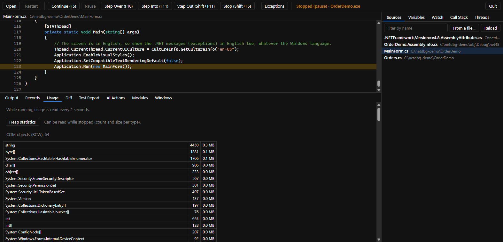

# netdbg 使用指南

[English](usage.md) · [日本語](usage.jp.md) · [简体中文](usage.zh-CN.md) · 繁體中文 · [한국어](usage.ko.md) · [README](../README.zh-TW.md)

> 本文件由 AI 機器翻譯。如有錯誤，歡迎透過 Issue 或 Pull Request 指正。

本指南介紹 netdbg 的用法：瀏覽器中的專用畫面（`--ui`）、透過 MCP 使用的 AI 用戶端，以及透過 DAP 使用的編輯器。圖片是偵錯 [`samples/OrderDemo`](../samples/OrderDemo) 中的範例程式（.NET Framework 4.8、x86 的小型 WinForms 訂單畫面）時擷取的。截圖中的畫面為英文；畫面會依 Windows 的顯示語言以繁體中文顯示，下文中的按鈕名稱使用繁體中文畫面上的名稱。

- [入門](#入門)
- [畫面（`--ui`）](#畫面--ui)
- [中斷點、逐步執行和運算式](#中斷點逐步執行和運算式)
- [沒有 PDB 的程式](#沒有-pdb-的程式)
- [執行時的記錄](#執行時的記錄)
- [程式的視窗](#程式的視窗)
- [使用量、堆積和洩漏](#使用量堆積和洩漏)
- [涵蓋範圍、測試報告和重新執行](#涵蓋範圍測試報告和重新執行)
- [編輯後繼續](#編輯後繼續)
- [從 AI 使用（MCP）](#從-ai-使用mcp)
- [從編輯器使用（DAP）](#從編輯器使用dap)
- [命令列](#命令列)
- [限制和疑難排解](#限制和疑難排解)

## 入門

1. 建置引擎（請參閱 [README](../README.zh-TW.md#建置)）。會得到 `dist\x86\netdbg.exe` 和 `dist\x64\netdbg.exe`。請讓這兩個資料夾保持並列：畫面會把位元數不同的程式交給另一個引擎。
2. 建置範例程式：

   ```powershell
   dotnet build samples\OrderDemo -c Debug -o C:\netdbg-demo\app
   ```

3. 在畫面中開啟它：

   ```powershell
   dist\x86\netdbg.exe --ui C:\netdbg-demo\app\OrderDemo.exe
   ```

   瀏覽器會開啟畫面，程式隨即啟動。不指定程式時，`netdbg --ui` 會開啟一個空白畫面；請用「開啟」來啟動或附加。

範例程式的合計會對 3 個以上的行給予 10% 的大量折扣，因此 3 杯茶（每杯 380）的合計是 1,026，而不是 1,140。下面的圖片就是依這個流程擷取的。

## 畫面（`--ui`）


- **工具列**：開啟、重新啟動、繼續 (F5)、暫停、不進入函式 (F10)、逐步執行 (F11)、跳離函式 (Shift+F11)、停止 (Shift+F5)、例外狀況（在哪些例外狀況停止）、結束。狀態顯示程式正在做什麼。
- **原始程式碼**（中間）：按一下行號可設定或移除中斷點。停止時，目前的行會被標出，目前方法中已執行的行會在 `//` 之後顯示變數的值。將滑鼠指向名稱可查看其值（物件展開一層）。
- **右側**：原始程式檔（程式的原始程式檔；可依名稱篩選，或從檔案開啟）、變數、監看式、呼叫堆疊、執行緒。
- **底部**：輸出（程式的輸出和運算式行的結果）、記錄、使用量、差異、測試報告、AI 操作、模組、視窗。最底部的行在目前的框架中評估 C# 運算式。

「開啟」有兩個索引標籤：

- *開啟程式*：exe（或 .NET 應用程式的 dll）、其引數，以及「收集涵蓋範圍」。
- *附加至處理序*：選擇正在執行的 .NET 或 .NET Framework 處理序。「僅觀察」會在不變更程式中任何內容的情況下附加（請參閱[下文](#僅觀察)）。

畫面只在 `127.0.0.1` 上接聽，URL 中帶有權杖。同一連接埠也提供 MCP，因此 AI 用戶端可以操作您正在查看的工作階段（請參閱[從 AI 使用](#從-ai-使用mcp)）。

## 中斷點、逐步執行和運算式


- 行中斷點可以在畫面上設定，也可以透過 DAP（`setBreakpoints`，含條件、叫用次數和記錄訊息）或 MCP（`breakpoint_set`，也可以依方法名稱設定，或作為追蹤點）設定。
- 例外狀況：可以選擇不停止（僅未處理的例外狀況）、使用者程式碼未處理時停止或每次擲回時都停止，也可以依型別選擇（「例外狀況」）。
- 在 async 方法中逐步執行時會跨越 await。設定下一個陳述式可以透過 DAP（`goto`）進行。
- 運算式依照 C# 編譯器給出的值和型別評估：運算子和轉換、明確轉換、方法和屬性呼叫、索引子、Lambda 和 LINQ（`Lines.Where(l => l.Quantity >= 3).Select(l => l.Product.Name)`）、`is` 和 `switch` 模式、字串插值、`dynamic`、匿名型別、物件 ID。方法和 getter 在程式中執行。
- 變數中物件旁邊的「路徑」可以找出該物件仍然存活的原因（請參閱[保留路徑](#使用量堆積和洩漏)）。

## 沒有 PDB 的程式


程式中沒有符號的模組會在「原始程式檔」中帶「反編譯並開啟」列出。引擎會將其反編譯為含序列點的 C#，因此中斷點、逐步執行、變數和涵蓋範圍都可以在反編譯的原始程式碼上使用。檔案快取在 `%LOCALAPPDATA%\netdbg\decompiled` 下。透過 DAP 時，將 `launch` / `attach` 的 `decompile` 設為 `"off"` 即可關閉；命令列 `netdbg --decompile <dll> <資料夾>` 會在不偵錯的情況下寫出 C#。

也能讀取 Windows PDB（舊格式）。要在其他資料夾中尋找 PDB，請設定 `NETDBG_SYMBOL_DIRS`（資料夾以 `;` 分隔）。

## 執行時的記錄


「記錄」索引標籤在不停止程式的情況下收集發生的事情。按一下某一列可查看其詳細資料和程式中的呼叫端（指向原始程式碼的連結）。

| 記錄 | 記錄的內容 |
|---|---|
| SQL | 透過 ADO.NET（Oracle ODP.NET、SqlClient、OleDb、Odbc）執行的陳述式：填入參數值的陳述式、參數、耗時、失敗、呼叫端和重複次數（N+1 查詢的徵兆）。請開啟「記錄 SQL」。 |
| 例外狀況 | 擲回的所有例外狀況（包括已攔截的），以及擲回時的呼叫堆疊和區域變數。請開啟「記錄例外狀況」。 |
| 事件 | 哪些事件處理常式、從哪個控制項、依什麼順序執行。 |
| 對話方塊 | `MessageBox.Show` 和 `ShowDialog`（WinForms 和 WPF）：文字、標題、表單型別、顯示它的程式碼。 |
| 交易 | 資料庫交易（與 SQL 記錄一起）：未結束的交易及其中的陳述式。 |
| 繫結 | 程式吞掉的 WinForms 資料繫結失敗。 |
| 子處理序 | `Process.Start` 的呼叫：檔案和引數。透過 DAP 的 `childProcesses` 也可以偵錯子處理序。 |
| UI 凍結 | UI 執行緒在 2 秒（預設）內不回應視窗訊息時，會在該執行緒上暫停程式。 |
| 環境 | 位元數、執行階段、使用者、電腦、OS、文化特性、時區、命令列、連接字串（密碼會隱藏）。 |

在「在 SQL 處中斷」和「在對話方塊處中斷」中輸入文字，程式會在包含這些文字的陳述式或對話方塊之前停止。

## 程式的視窗


「視窗」讀取程式的視窗（WinForms 和 WPF）：包含種類、名稱和文字的控制項樹狀結構，以及視窗的截圖。選擇控制項後會在截圖上框出它。程式停止時也可以截圖（是最後一次繪製的畫面，而不是「沒有回應」的殘影）。按按鈕和輸入文字由 AI 工具（`ui_invoke`、`ui_set_text`、`ui_select`、`ui_toggle`、`ui_keys`、`ui_mouse`）完成，或透過重新執行記錄的步驟完成。

## 使用量、堆積和洩漏



- 「使用量」在執行時顯示私用位元組、工作集、CPU、GDI 和 USER 物件（相對於其配額）、控制代碼；對於 32 位元程式，還顯示其位址空間和最大可用區塊（32 位元程式中的 `OutOfMemoryException` 通常表示最大可用區塊變小了）。
- 「堆積統計」（停止時）依型別統計物件的數量和大小，以及存活的 COM 物件（RCW）。
- 變數中物件旁邊的「路徑」（MCP：`retention_path`）給出從 GC 根到該物件的最短參考鏈。
- **資料中斷點**（MCP：`break_on_write`；DAP：data breakpoints）在任何程式碼寫入物件的欄位時停止。僅限 .NET（不支援 .NET Framework）。在 x86 上，如果原生程式碼（反映的第一次 `SetValue`、P/Invoke 的回寫）寫入被監看的欄位，程式會結束；設定監看時引擎會告知這一點。

## 涵蓋範圍、測試報告和重新執行


在「開啟」中開啟「收集涵蓋範圍」（DAP：`coverage`；MCP：`coverage`）。已執行的行標記為 ●，未執行的行標記為 ○，只走過部分方向的分支標記為 ◐（將滑鼠指向標記可查看是哪個方向）。比率顯示在頂部和「原始程式檔」中的每個檔案旁；「寫入 XML」會寫出 Cobertura XML，並把其中的全部原始程式收成旁邊的一個 HTML（`*.coverage.html`，執行結束時也會寫出），ReportGenerator、GitHub、Azure Pipelines 和 GitLab 都能讀取該 XML。


「測試報告」記錄測試項目：輸入編號和標題，按「開始」，操作程式（手動或由 AI），然後按「以 OK 結束」或「以 NG 結束」。每個操作都會記錄一張標出操作位置的截圖和一張操作後視窗的截圖，以及其間變更的控制項、SQL、訊息和例外狀況。「寫出報告」會寫出 Excel 活頁簿和一個獨立的 HTML 檔案，以及可用「重新執行」再次執行的 `.steps.json`（例如在新的建置上）。也可以使用貴單位自己的格式作為範本（從「匯出預設範本」開始）。

「差異」比較兩次建置（exe、dll 或資料夾；不需要符號）並列出變更的方法；指定涵蓋範圍 XML 時，也會列出已變更但未執行的方法。命令列也可以做同樣的事：`netdbg --diff old.exe new.exe --coverage run.cobertura.xml`。

## 編輯後繼續

在程式執行或停止時修改 C# 原始程式碼，儲存並套用（DAP：`netdbg.applyChanges`；MCP：`debug_apply_changes`）。需要電腦上有 .NET SDK 9.0.200 或更新版本（差異由其 Roslyn 產生）、Debug 建置以及可攜式 PDB（舊式 .NET Framework 專案只要使用 `<DebugType>portable</DebugType>` 也可以）。使用 Windows PDB 時，引擎會告訴您如何切換。執行階段無法套用的編輯（例如變更方法的簽章）會連同原因一起被拒絕。

## 從 AI 使用（MCP）


上圖列出了用範例程式實際進行的 MCP 呼叫和回應（頂部的要求是範例）。AI 設定中斷點，在程式的視窗中輸入文字，按 **Add**，然後讀取停止的位置和值；回應表明大量折扣已生效。


AI 所做的一切都會連同引數和時間列在「AI 操作」中，旁邊是程式的視窗。

### 兩種連線方式

| | 方法 | 適用情境 |
|---|---|---|
| AI 執行引擎 | 註冊 `netdbg.exe --mcp`。AI 用 `debug_launch` / `debug_attach` 啟動或附加。 | AI 單獨偵錯。 |
| AI 加入您的工作階段 | 開啟畫面（`netdbg --ui`），或從編輯器用 `--mcp-listen` 啟動引擎，然後註冊 `netdbg.exe --mcp-connect`。每次呼叫時它都會連線到最新的工作階段（或用 `--mcp-connect=<PID>` 指定的引擎）。 | 您和 AI 查看同一個程式。 |

用 `--ui` 或 `--mcp-listen` 啟動的引擎會將其位址寫入 `%LOCALAPPDATA%\netdbg\mcp\<PID>.json`；畫面的「AI 操作」索引標籤中也會顯示。

### 註冊

Claude Code：

```powershell
claude mcp add --scope user netdbg -- "C:\tools\netdbg\x86\netdbg.exe" --mcp-connect
```

GitHub Copilot CLI：`copilot mcp add netdbg -- "C:\tools\netdbg\x86\netdbg.exe" --mcp-connect`。

以 `mcpServers` JSON 設定的用戶端（Claude Desktop、Cursor `~\.cursor\mcp.json`、Gemini CLI `~\.gemini\settings.json`、Windsurf `~\.codeium\windsurf\mcp_config.json`、LM Studio `~\.lmstudio\mcp.json`）：

```json
{
  "mcpServers": {
    "netdbg": { "command": "C:\\tools\\netdbg\\x86\\netdbg.exe", "args": ["--mcp-connect"] }
  }
}
```

Codex（`~\.codex\config.toml`）：

```toml
[mcp_servers.netdbg]
command = "C:\\tools\\netdbg\\x86\\netdbg.exe"
args = ["--mcp-connect"]
```

要讓 AI 自己執行引擎，請按位元數用 `--mcp` 註冊。使用與目標相同位元數的伺服器。exe 旁邊需要相同位元數的 `dbgshim.dll` 和 `encdelta`。

```json
{
  "mcpServers": {
    "netdbg-x86": { "command": "C:\\tools\\netdbg\\x86\\netdbg.exe", "args": ["--mcp"] },
    "netdbg-x64": { "command": "C:\\tools\\netdbg\\x64\\netdbg.exe", "args": ["--mcp"] }
  }
}
```

### 工具

| 分組 | 工具 |
|---|---|
| 工作階段 | `debug_launch`、`debug_attach`、`debug_open_dump`、`debug_status`、`debug_continue`、`debug_pause`、`debug_step`、`debug_wait_for_stop`、`debug_terminate`、`debug_output` |
| 中斷點 | `breakpoint_set`（行、方法、條件、追蹤點）、`breakpoint_remove`、`breakpoint_list`、`breakpoint_clear`、`trace_log`、`exception_breakpoints`、`break_on_write`、`sql_break` |
| 檢查 | `debug_stop_context`（一次呼叫即可得到停止位置、周圍的原始程式碼、區域變數和例外狀況）、`stack_trace`、`threads`、`variables`、`evaluate`、`set_variable`、`exception_info`、`source_context`、`modules`、`decompile` |
| 程式的視窗 | `ui_tree`、`ui_find`、`ui_screenshot`、`ui_invoke`、`ui_set_text`、`ui_select`、`ui_toggle`、`ui_keys`、`ui_mouse`、`ui_window`、`ui_wait_for`、`ui_changes`、`ui_replay` |
| 記錄 | `sql_log`、`exception_log`、`event_trace`、`dialog_log`、`binding_log`、`transactions`、`environment`、`ui_freeze` |
| 記憶體 | `process_usage`、`retention_path` |
| 測試 | `coverage`、`assembly_diff`、`test_item`、`test_report` |
| 編輯後繼續 | `debug_apply_changes` |

典型流程：`breakpoint_set` → `debug_launch`（或加入工作階段）→ 用 `ui_set_text` / `ui_invoke` 重現 → `debug_stop_context` → `evaluate` → `debug_continue`。使程式執行的呼叫（`ui_invoke`、`debug_continue`、`debug_step`）接受 `waitMs`，程式停止時會提前回應並告知停止的位置。工具的說明（供 AI 閱讀）為英文。

## 從編輯器使用（DAP）

任何 DAP 用戶端都可以將引擎作為其配接器啟動（`netdbg.exe` 或 `netdbg.exe --interpreter=vscode`，透過標準輸入和輸出；加上 `--mcp-listen` 可讓 AI 加入）。引數名稱沿用 C# 延伸模組 `launch.json` 的名稱。

`launch`：

| 引數 | |
|---|---|
| `program` | exe，或 .NET 應用程式的 dll（此時用 `dotnet` 啟動）。 |
| `args`、`cwd`、`env` | 引數、工作資料夾、環境變數（`null` 移除該變數）。 |
| `stopAtEntry` | 在第一行停止。 |
| `justMyCode`、`enableStepFiltering` | 預設為 `true`。 |
| `expressionEvaluationOptions.allowImplicitFuncEval` | `false`：顯示變數時不執行屬性的 getter。 |
| `decompile` | `"off"`：不反編譯沒有 PDB 的模組。 |
| `editAndContinue` | 預設為 `true`。 |
| `coverage` | `true`，或 `{ "output": 檔案 }` / `{ "folder": 資料夾 }`。 |
| `sqlLog`、`exceptionLog` | `true`，或 `{ "enabled", "methods" }` / `{ "enabled", "snapshot" }`。 |
| `dialogLog` | 預設記錄；`false` 關閉。 |
| `uiFreeze` | `true` / `false`，或 `{ "enabled", "thresholdMs" }`。 |
| `childProcesses` | `"record"`（預設）、`"follow"` 或 `"off"`。 |
| `dumpPath` | 不啟動程式，而是開啟損毀傾印（完整記憶體）。 |

`attach`：`processId`（數字或字串）、`observeOnly`，以及相同的偵錯選項。

引擎也會回應自己的要求並傳送自己的事件，名稱為 `netdbg.*`（例如 `netdbg.setSqlLog`、`netdbg.heapStats`、`netdbg.retentionPath`、`netdbg.decompile`、`netdbg.applyChanges`），並在 `initialize` 的回應中以 `netdbgSupports*` 功能告知。引擎的訊息使用 DAP `initialize` 的 `locale` 所示的語言。

<a id="僅觀察"></a>
### 僅觀察

用 `observeOnly` 附加（畫面上為「僅觀察」）適用於偵錯工具不得變更資料的共用測試環境。變更值、編輯後繼續、設定下一個陳述式、執行程式的函式（運算式中的屬性 getter、`ToString`、方法呼叫）以及對其視窗輸入都會連同原因一起被拒絕。欄位、堆疊、記錄和截圖仍然可以使用。

## 命令列

```text
netdbg [--interpreter=vscode | --mcp | --mcp-listen | --mcp-connect[=<PID>]] [--log=<file>]
netdbg [--log=<file>] --ui [--no-open] [--attach <PID> | <program> [<arguments>...]]
netdbg --decompile <dll> <dir>
netdbg --diff <old> <new> [--coverage <xml>]
netdbg --version
```

`--no-open` 不開啟瀏覽器（會輸出 URL）。`--log` 將 DAP 通訊和引擎的事件寫入檔案。畫面和訊息的語言依照 Windows 的顯示語言；可以用 `NETDBG_LANG`（`en`、`ja`、`zh-CN`、`zh-TW`、`ko`）指定。

## 限制和疑難排解

- **位元數。** 偵錯工具必須與程式的位元數相同。`--ui` 會自行把程式交給另一個引擎（請讓 `x86` 和 `x64` 並列）。透過 DAP 和 MCP 時，請使用位元數相符的引擎；不相符時引擎會告知。
- **.NET Framework 2.0 到 3.5** 的程式會被拒絕（僅支援 4.x）。支援 .NET Core 3.0 及更新版本。
- **資料中斷點**僅限 .NET；在 x86 上，原生程式碼寫入被監看的欄位會使程式結束。
- **截圖和輸入**需要程式的桌面：Windows 鎖定期間無法使用；同時使用滑鼠和鍵盤可能會干擾 `ui_keys` 和 `ui_mouse`。
- **編輯後繼續**需要 .NET SDK 9.0.200 或更新版本以及可攜式 PDB。
- 發現問題時，請先加上 `--log=<檔案>`，查看要求和回應。
